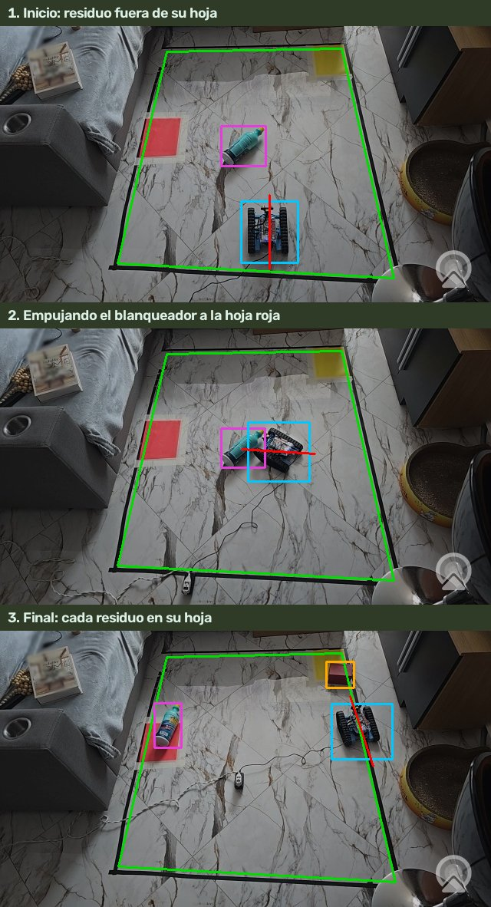

# mBot de residuos

Sistema de clasificación autónoma de residuos con visión artificial. Una cámara cenital supervisa un área de trabajo delimitada con cinta, unos modelos YOLO11n entrenados con datos propios detectan y clasifican los residuos, y un robot móvil **mBot Ranger** traslada cada residuo a su zona de destino. Los eventos de clasificación se publican en un panel web local y se registran en Google Sheets mediante **n8n**.

| Zona de destino | Categoría | Residuos |
|---|---|---|
| Amarilla | Aprovechables | Caja de cartón, lata, botella de vidrio, botella de plástico |
| Roja | Peligrosos | Envase de blanqueador |

**Estado (versión 1.0, 02/11/2026):** prototipo validado en entorno de laboratorio, con verificación física de extremo a extremo (detección, traslado, conteo, registro en Google Sheets y acuse en el panel). Las limitaciones conocidas están en la sección 13 de la documentación técnica.



## Documentación

| Documento | Contenido |
|---|---|
| [Documentación técnica del sistema](docs/DOCUMENTACION_TECNICA.md) ([PDF](docs/mBot_de_residuos_documentacion.pdf)) | Requisitos, arquitectura, diseño detallado, interfaces, configuración, seguridad, despliegue, operación, modelos, verificación y riesgos |
| [Manual de uso](docs/USO.md) | Operación del sistema y controles |
| [Instalación](docs/INSTALACION.md) | Requisitos, dependencias y modelos |
| [Integración con n8n](docs/N8N.md) | Flujo, contrato del webhook y configuración de Google Sheets |
| [Robot y firmware](docs/ROBOT.md) | Protocolo BLE, firmware V2 y carga por USB |
| [Arquitectura](docs/ARQUITECTURA.md) | Módulos, hilos y archivos |
| [Entrenamiento](docs/ENTRENAMIENTO.md) | Conjuntos de datos, etiquetado y métricas |
| [Estado](docs/ESTADO.md) / [Problemas conocidos](docs/PROBLEMAS.md) | Registro de pruebas y resolución de incidencias |

Material didáctico para la exposición del proyecto: [guía de estudio](docs/GUIA_DE_ESTUDIO.md) ([PDF](docs/Guia_de_estudio_mBot_de_residuos.pdf)).

## Inicio rápido

```sh
outputs/n8n/Abrir_n8n.command                                   # n8n en http://localhost:5678
work/venv/bin/python outputs/vision_linea_robot.py              # sistema principal
open http://127.0.0.1:8765                                      # panel de monitorización
```

Controles: `C` conectar · `E` habilitar · `G` modo automático · `Espacio` parar · `Q` salir.

## Requisitos

- macOS en Apple Silicon (captura de vídeo mediante AVFoundation), Python 3.13 y Node.js ≥ 24 para n8n.
- Cámara externa (Samsung con Camo o Microsoft LifeCam) y mBot Ranger con firmware `RANGER_READY_V2_20261019`.
- Modelos entrenados en `outputs/models/`. Los pesos no se versionan: los propios (`residuos-propio.pt`, `robot-propio.pt`) se obtienen del autor y los generales con `outputs/preparar_modelos.py`.

## Pruebas

```sh
work/venv/bin/python -m unittest discover -s tests              # 149 casos, sin hardware
```
