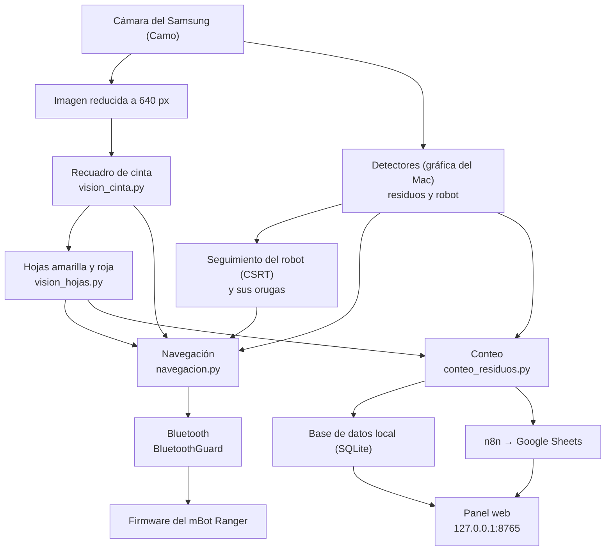
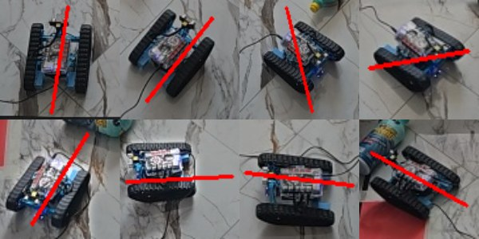

# Cómo está hecho por dentro

Actualizado: 2 de noviembre de 2026

Documento principal: [Documentación técnica del sistema](DOCUMENTACION_TECNICA.md).

[Inicio](../README.md) · [Estado](ESTADO.md) · [Uso](USO.md) · [Operación](OPERACION_V2.md)

Este documento explica qué piezas tiene el programa, en qué orden trabajan y en qué archivo está cada una. No hace falta saber programar para seguirlo; los términos técnicos se explican la primera vez que aparecen.

## Palabras que conviene conocer

| Término | Qué es |
|---|---|
| **Detector** (YOLO) | Programa de inteligencia artificial que mira una imagen y dibuja un rectángulo («caja») alrededor de cada objeto que conoce, con un nombre y una confianza de 0 a 1. Usamos YOLO11n, un modelo pequeño y rápido, entrenado con fotos nuestras. |
| **Entrenar** | Enseñar a un detector con fotos en las que ya se marcó a mano dónde está cada objeto. Ver [Entrenamiento](ENTRENAMIENTO.md). |
| **Seguimiento** (CSRT) | Método de OpenCV que, una vez se sabe dónde está el robot, lo sigue de una imagen a la siguiente sin volver a reconocerlo. Es más rápido que el detector, pero se puede despistar. |
| **Coordenadas del recuadro** | En vez de medir posiciones en píxeles de la imagen, el programa «aplana» el recuadro de cinta a un cuadrado de 400 × 400 unidades, como si se viera desde arriba. Así, si la cámara se mueve un poco, las posiciones no cambian. La transformación se llama homografía. |
| **Firmware** | El pequeño programa que vive en la placa del robot y obedece las letras que le llegan. |
| **BLE** | Bluetooth de bajo consumo, por donde el Mac manda las letras al robot. |
| **GPU / MPS** | La tarjeta gráfica del Mac (Apple M5). Los detectores van unas seis veces más rápido en ella. |
| **Webhook** | Una dirección web que, al recibir un mensaje, pone en marcha un flujo de n8n. |

## El recorrido de una imagen



Paso a paso:

1. **Cámara** (`vision_ranger.Camera`, `camaras_mac.py`). Elige sola la única cámara externa reconocida (Samsung, Camo o LifeCam) y rechaza siempre la del Mac. Guarda la imagen original y hace una copia reducida a 640 px de lado mayor (640 × 360 en el teléfono), que es la que usan el recuadro, el seguimiento y el conteo. La original se usa en los detectores y en el zoom. Si el robot está en marcha y la imagen no cambia en 0,6 s (Camo congelado), se detiene.
2. **Recuadro de cinta** (`vision_cinta.py`). Busca zonas más oscuras que el suelo de alrededor, encuentra rectas largas y prueba combinaciones de cuatro que formen un cuadrilátero creíble: cinta en los cuatro lados (aunque algún trozo esté tapado), suelo claro a los dos lados de la cinta (así no confunde sombras) e interior casi sin cinta. Se confirma cuando aparece en el mismo sitio en al menos 6 imágenes durante 0,4 s (`vision_boundary.AutoBoundary`). Con el recuadro ya confirmado, la búsqueda completa se hace una imagen de cada tres y entre medias solo se comprueba que la cinta siga en su sitio.
3. **Hojas de color** (`vision_hojas.py`). Dentro del recuadro busca una mancha grande, rectangular y de color saturado: amarilla, o roja **casi tan clara como el suelo o más** (la caja roja es más oscura y así no se confunde). Se confirma al verla en el mismo sitio 5 veces durante 1 s y se recuerda en coordenadas del recuadro, aunque luego un residuo o el robot la tapen. Si un residuo encima la parte en trozos, también la reconoce.
4. **Detectores** (`vision_ranger.WasteDetector`). En un hilo aparte (un hilo es una tarea que corre a la vez que las demás), el único que usa la gráfica, se ejecutan:
   - el **detector de residuos** propio (`models/residuos-propio.pt`, cinco clases), sobre la imagen original a 800 px;
   - el **detector del robot** propio (`models/robot-propio.pt`), a 640 px.

   Los detectores generales (YOLO-World y Grounding DINO + CLIP) quedan apagados porque se equivocaban mucho más; `--otros-residuos` los enciende. Para que un residuo aparezca, el detector propio debe verlo con confianza 0,6 en un análisis, o 0,5 en dos; una vez visto, se mantiene aunque la confianza baje un poco, y su nombre es el más votado en los últimos análisis (así no parpadea). Sobre su propia hoja basta menos confianza, porque el fondo de color lo hace más difícil de ver. Varias reglas evitan errores típicos: si dos clases caen casi en la misma caja y una es blanqueador, gana el blanqueador; una detección que es solo la hoja (la roja parecía una «caja») se descarta; lo que cae sobre el robot no es un residuo.
5. **Robot** (programa principal). Cuando el detector del robot lo ve con confianza 0,5, empieza el seguimiento CSRT. Si el seguimiento se aleja de lo que dice el detector, se corrige; si el aspecto cambia demasiado, se da por perdido y se vuelve a buscar. Sin el modelo del robot, lo busca Grounding DINO (más lento). `R` permite elegirlo a mano.
6. **Orugas** (`vision_orugas.py`). Dentro de la caja del robot busca las dos franjas oscuras paralelas (las orugas) y saca su dirección. Así se sabe hacia dónde mira el robot sin moverlo, aunque no cuál es el frente; eso lo decide la navegación con lo que ya sabe.

   

7. **Navegación** (`navegacion.py`, clase `GoToWaste`). No envía nada por sí misma: en cada imagen decide la siguiente orden («avanza 0,2 s», «gira a la izquierda 0,1 s»…). Elige el residuo más cercano con el camino libre que no esté ya en su hoja, se coloca detrás de él en la línea hacia el centro de su hoja y lo empuja hasta dejarlo encima. Mide hacia dónde mira el robot con las orugas y con lo que se desplaza tras cada paso, y aprende cuánto gira por segundo. El detalle está en [Operación](OPERACION_V2.md#el-modo-automático-tecla-g).
8. **Bluetooth** (`vision_ranger.BluetoothGuard`, `ranger_bluetooth.py`). Es el único que habla con el robot. Cada 60 ms mira la orden vigente: si es segura y no ha caducado, envía la letra; si no, envía `x` (parar). Si el robot sale del recuadro, envía `p` (pitido) cada 2 s.
9. **Firmware** (`ranger_bluetooth.ino`). Mueve los motores con cada letra y los para solo si pasan 600 ms sin órdenes nuevas.
10. **Conteo** (`conteo_residuos.py`, clase `SeparationCounter`). Sigue cada residuo en coordenadas del recuadro y apunta un evento cuando queda sobre su hoja habiendo estado antes fuera de ella. Lo guarda en `work/estadisticas.sqlite3`.
11. **Panel web** (`dashboard.py`, `dashboard/index.html`). Un pequeño servidor que solo escucha en el propio Mac lee esa base de datos y la imagen en vivo, y la página se actualiza cada medio segundo.
12. **n8n** (`aviso_n8n.py`, carpeta `n8n/`). Cada evento nuevo se envía, en un hilo aparte, al webhook de n8n, que lo apunta en Google Sheets y contesta un mensaje que se ve en el panel. Si n8n está cerrado, los avisos esperan y se reintentan. Ver [N8N.md](N8N.md).

### Tareas que corren a la vez

| Tarea | Qué hace | Por qué va aparte |
|---|---|---|
| Bucle principal | Cámara, recuadro, hojas, seguimiento, navegación, dibujo y teclas, muchas veces por segundo. | Es lo que vigila la seguridad: nunca espera a nada lento. |
| Detector (gráfica) | Residuos y robot, varias veces por segundo. | Solo un hilo puede usar la gráfica: con dos a la vez el programa se cerraba. |
| Grounding DINO (procesador) | Solo si falta el modelo del robot o con `--otros-residuos`. ~1,2 s por análisis. | Es lento. |
| Bluetooth | Envía la orden vigente cada 60 ms. | La radio puede tardar; no debe frenar la imagen. |
| n8n | Envía los residuos contados. | La red puede tardar o fallar; nunca frena al robot. |
| Servidor del panel | Atiende al navegador. | Para ver el panel mientras el robot trabaja. |

Los modelos se cargan de uno en uno al arrancar: cargarlos a la vez dejaba alguno inservible.

## Archivos de `outputs/`

### Programa actual

| Archivo | Qué contiene |
|---|---|
| `vision_linea_robot.py` | Programa principal: une todas las piezas, dibuja la ventana y atiende las teclas. |
| `vision_ranger.py` | Cámara, detectores (`WasteDetector`), estado de las órdenes y el guardián del Bluetooth. Si se ejecuta solo, abre el modo antiguo con etiqueta ArUco. |
| `camaras_mac.py` | Lista las cámaras del Mac, reconoce Samsung, Camo y LifeCam, y rechaza la del Mac. |
| `vision_cinta.py` | Detector del recuadro de cinta (desde el 27/10). |
| `vision_boundary.py` | Confirma el recuadro y decide si sigue visible. |
| `vision_core.py` | Geometría de líneas y recuadros; también el detector antiguo de recuadro. |
| `vision_hojas.py` | Hojas de color, qué residuo va a cada hoja (`DESTINO`) y cuándo un residuo está «en su hoja». |
| `vision_orugas.py` | Dirección del robot por sus orugas. |
| `vision_residuos.py` | Estabilidad de las detecciones (que no parpadeen) y la regla de precaución plástico/blanqueador. |
| `vision_papel.py` | Grounding DINO + CLIP: papel, envolturas y, de respaldo, el robot. |
| `vision_zoom.py`, `vision_superres.py` | Zoom digital y mejora de imagen con IA (solo para mirar de cerca). |
| `navegacion.py` | Modo automático (tecla G). |
| `conteo_residuos.py` | Conteo de residuos separados y base de datos. |
| `dashboard.py`, `dashboard/index.html` | Panel web. |
| `aviso_n8n.py`, `n8n/registro_residuos.json` | Envío a n8n y el flujo de n8n para importar. |
| `ranger_bluetooth.py` | Conexión Bluetooth con el robot y consola manual. |
| `ranger_bluetooth.ino`, `ranger-bluetooth.mblock` | Firmware V2 de la placa y su proyecto de mBlock. |
| `actualizar_ranger.py` | Compila y carga el firmware por USB. |
| `recoger_imagenes.py` | Toma fotos para entrenar. |
| `entrenar_detector.py` | Entrena un detector YOLO11n con las fotos etiquetadas. |
| `preparar_modelos.py` | Descarga los modelos generales. |
| `requirements_vision.txt` | Bibliotecas de Python necesarias. |

### Lanzadores (doble clic en el Mac)

| Archivo | Abre |
|---|---|
| `Probar_Robot_Linea.command` | El programa principal con el robot. **Es el de la demostración.** |
| `Abrir_Dashboard.command` | Solo el panel web, sin cámara (para consultar el historial). |
| `Actualizar_Ranger.command` | La carga del firmware por USB. |
| `Recoger_Imagenes.command` | La toma de fotos para entrenar. |
| `n8n/Abrir_n8n.command` | n8n en este Mac. |
| `Detectar_Residuos.command` | El programa principal sin robot (`--solo-vision`). |
| `Iniciar_Vision.command` | Igual que `Probar_Robot_Linea.command` (nombre antiguo). |
| `Iniciar_Bluetooth.command`, `Iniciar_Ranger.command`, `Detectar_Linea.command` | Consola Bluetooth, consola USB antigua y prueba de líneas negras. |

### Histórico (se conserva, no se usa en la demostración)

- `vision_linea.py`: prueba de líneas negras sueltas.
- `vision_ranger.py` ejecutado solo, con `Etiqueta_Ranger.png`: modo antiguo con etiqueta ArUco (un código impreso encima del robot).
- `ranger.py`, `ranger_usb.ino`: control antiguo por cable USB.
- `ranger-original.ino`, `ranger-original.mblock`: copia del programa de la placa anterior.
- `Pendiente_Sensor_Linea.md`: el requisito aplazado del sensor de línea.
- `LEEME_Vision.md`, `LEEME_Bluetooth.md`: notas antiguas que apuntan a estos manuales.

## Modelos

Los modelos son archivos grandes y **no están en GitHub** (`.gitignore` los excluye). Van en `outputs/models/`.

| Archivo | Qué es | De dónde sale |
|---|---|---|
| `residuos-propio.pt` | Detector propio de los cinco residuos (1/11) | Entrenado por Juan: **hay que pedírselo** |
| `robot-propio.pt` | Detector propio del robot (28/10) | Entrenado por Juan: **hay que pedírselo** |
| `residuos-world-small.pt` | Detector general YOLO-World con 24 descripciones de residuos | Lo genera `preparar_modelos.py`. El programa lo carga siempre, aunque esté apagado. |
| `yolov8s-worldv2.pt`, `yolo11n.pt` | Modelos base oficiales | `preparar_modelos.py` |
| `clip/ViT-B-32.pt`, `grounding-dino-tiny/` | CLIP y Grounding DINO, para papel, envolturas y respaldo del robot | `preparar_modelos.py` (los archivos de configuración de DINO sí están en GitHub; los pesos no) |
| `superres/FSRCNN_x2.pb` | Mejora de imagen ×2 para el zoom | `preparar_modelos.py` |
| `residuos-categorias.json` | Las 24 descripciones del detector general | En GitHub |

En el Mac de Juan hay además versiones anteriores (`residuos-propio-v1.pt`, `residuos-propio-v3.pt`, `residuos-v2.pt`…, `robot-v0.pt`) que no se usan.

## Pruebas automáticas (`tests/`)

149 pruebas que no necesitan cámara ni robot: comprueban con imágenes y situaciones simuladas la elección de cámara, el recuadro, las hojas, la estabilidad de las detecciones, la navegación (con un robot simulado), el conteo, el panel, el envío a n8n, la toma de fotos y el zoom. Se ejecutan con:

```sh
work/venv/bin/python -m unittest discover -s tests
```

## Carpetas locales y GitHub

- `work/` (no se sube): el entorno de Python, las fotos y etiquetas de entrenamiento, las grabaciones de las pruebas, la base de datos del conteo (`work/estadisticas.sqlite3`), la instalación de n8n (`work/n8n`) y las herramientas de etiquetado usadas para entrenar.
- `outputs/models/*.pt` (no se suben): los modelos.
- Todo el análisis de imagen se hace en el Mac. A n8n solo se envían datos del conteo (fecha, hora, residuo, hoja, confianza, sesión), nunca imágenes. La instalación sí necesita Internet para bajar bibliotecas y modelos.
