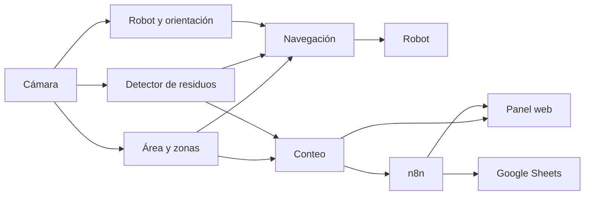
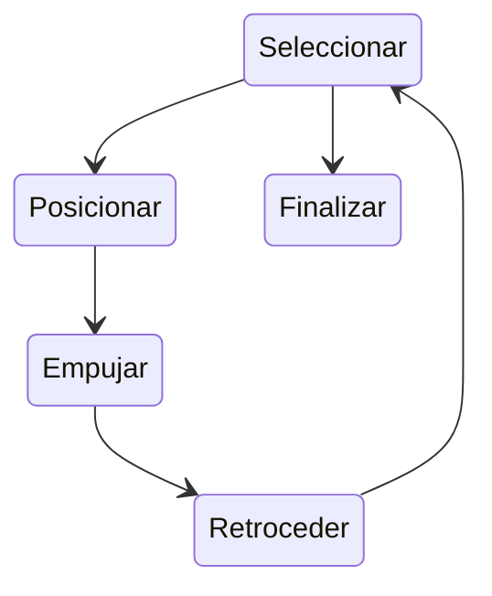
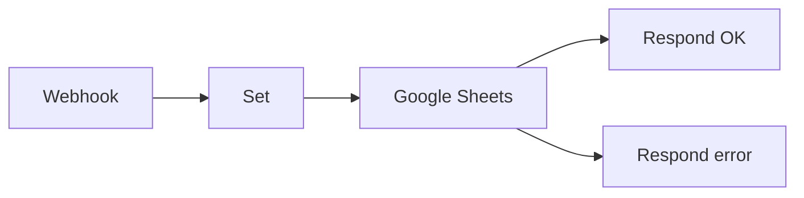

# mBot de residuos: documentación técnica del sistema

## Control del documento

| Campo | Valor |
|---|---|
| Sistema | mBot de residuos: clasificación autónoma de residuos con visión artificial |
| Tipo de documento | Documento técnico de sistema (arquitectura, diseño, interfaces y operación) |
| Versión | 1.0 |
| Fecha | 2 de noviembre de 2026 |
| Autor | Juan Manuel Arango Bedoya |
| Estado | Prototipo validado en entorno de laboratorio |
| Repositorio | https://github.com/jArango82/mBot_de_residuos (rama `main`) |
| Revisión de código de referencia | `64c939e` |

### Historial de versiones del documento

| Versión | Fecha | Descripción |
|---|---|---|
| 0.x | 05/10/2026 – 26/10/2026 | Guías de instalación, uso y estado de las primeras versiones |
| 1.0 | 02/11/2026 | Documento técnico consolidado: clasificación en zonas de destino, navegación autónoma, orientación por orugas, integración con n8n |

---

## 1. Introducción

### 1.1 Propósito

Este documento describe la arquitectura, el diseño detallado, las interfaces, la configuración, el despliegue, la operación y la verificación del sistema *mBot de residuos*. Está dirigido a desarrolladores, integradores y evaluadores técnicos que necesiten comprender, mantener o ampliar el sistema.

### 1.2 Alcance

El sistema detecta residuos dentro de un área de trabajo delimitada en el suelo, los clasifica en cinco categorías y ordena a un robot móvil que traslade cada residuo a la zona de destino que le corresponde. Registra cada clasificación completada, la publica en un panel web local y la envía a un servicio de automatización (n8n) que la persiste en Google Sheets.

**Dentro del alcance:**

- Adquisición de vídeo cenital, detección del área de trabajo y de las zonas de destino.
- Detección y clasificación de residuos con modelos entrenados con datos propios.
- Localización y estimación de orientación del robot sin marcadores fiduciales.
- Planificación y control de movimiento por pasos con realimentación visual.
- Conteo de eventos de clasificación, panel de monitorización e integración con n8n.

**Fuera del alcance:**

- Manipulación con pinza o recogida de residuos (el robot empuja).
- Planificación de rutas óptimas entre varios residuos.
- Ejecución en Windows o Linux del subsistema de visión.
- Operación sin supervisión humana.

### 1.3 Definiciones y acrónimos

| Término | Definición |
|---|---|
| Área de trabajo | Cuadrilátero delimitado con cinta negra sobre el suelo |
| Zona de destino | Hoja de color dentro del área de trabajo: amarilla (aprovechables) o roja (peligrosos) |
| Plano del área | Sistema de coordenadas normalizado de 400 × 400 unidades, obtenido por homografía de las esquinas del área |
| BLE | Bluetooth Low Energy |
| CSRT | *Channel and Spatial Reliability Tracker*, seguidor visual de OpenCV |
| Homografía | Transformación proyectiva entre la imagen y el plano del área |
| HSV | Espacio de color tono–saturación–valor |
| MPS | *Metal Performance Shaders*, backend de GPU de Apple usado por PyTorch |
| YOLO11n | Modelo de detección de objetos de Ultralytics, variante *nano* |
| Webhook | Punto de entrada HTTP que inicia un flujo de n8n |
| Evento de clasificación | Llegada confirmada de un residuo a su zona de destino |

### 1.4 Referencias

| Documento | Ubicación |
|---|---|
| Manual de uso | `docs/USO.md` |
| Instalación | `docs/INSTALACION.md` |
| Robot, protocolo y firmware | `docs/ROBOT.md` |
| Integración con n8n | `docs/N8N.md` |
| Entrenamiento de modelos | `docs/ENTRENAMIENTO.md` |
| Estado y registro de pruebas | `docs/ESTADO.md` |
| Problemas conocidos | `docs/PROBLEMAS.md` |

---

## 2. Descripción general del sistema

### 2.1 Contexto

Una cámara situada sobre el área de trabajo envía vídeo a un ordenador macOS. El software del ordenador realiza toda la percepción y la toma de decisiones, y envía órdenes elementales al robot por BLE. El robot ejecuta las órdenes con un firmware propio que incorpora un temporizador de seguridad.

| Actor o sistema | Función | Interfaz |
|---|---|---|
| Cámara (Samsung Galaxy S24 Ultra con Camo) | Fuente de vídeo cenital | AVFoundation (cámara virtual) |
| Ordenador (MacBook, Apple M5) | Percepción, planificación, conteo, panel | — |
| Robot (mBot Ranger, placa Auriga ATmega2560) | Actuador | BLE (GATT) y USB serie para carga de firmware |
| Operador | Supervisión, arranque y parada | Teclado de la ventana del programa |
| Navegador web | Monitorización | HTTP `127.0.0.1:8765` |
| n8n (local) | Automatización del registro | HTTP `localhost:5678/webhook/residuos` |
| Google Sheets | Registro persistente externo | API de Google, vía credencial OAuth2 de n8n |

### 2.2 Funcionalidad principal

1. Detección automática y confirmación del área de trabajo y de las zonas de destino.
2. Detección y clasificación de residuos: caja de cartón, lata, botella de vidrio y botella de plástico (destino amarillo); envase de blanqueador (destino rojo).
3. Localización del robot y estimación de su orientación a partir de la geometría de sus orugas.
4. Traslado autónomo de cada residuo a su zona de destino mediante empuje.
5. Conteo de eventos de clasificación, visualización en tiempo real y registro en Google Sheets.

---

## 3. Requisitos

Estado de verificación: **F**: verificado físicamente con el sistema real. **S**: verificado en simulación. **U**: cubierto por pruebas unitarias. **I**: implementado, sin verificación específica.

### 3.1 Requisitos funcionales

| ID | Requisito | Verificación |
|---|---|---|
| RF-01 | El sistema adquirirá vídeo de una cámara externa y rechazará la cámara integrada del equipo | F, U |
| RF-02 | El sistema detectará y confirmará automáticamente el área de trabajo; el operador podrá reiniciarla (`T`) o confirmarla manualmente (`B`) | F, U |
| RF-03 | El sistema detectará las zonas de destino amarilla y roja, incluso parcialmente ocultas por un residuo | F, U |
| RF-04 | El sistema clasificará los residuos en las cinco categorías definidas | F (vidrio con baja tasa de detección) |
| RF-05 | Ante ambigüedad entre botella de plástico y envase de blanqueador, el sistema aplicará la clase peligrosa | U |
| RF-06 | El sistema localizará el robot y estimará su orientación sin marcadores | F |
| RF-07 | En modo automático (`G`), el robot trasladará cada residuo a su zona de destino hasta que no quede ninguno pendiente | F, S |
| RF-08 | El operador podrá mover el robot manualmente por pasos (`W`, `A`, `S`, `D`) | F |
| RF-09 | El sistema contará un evento cuando un residuo, visto fuera de su zona, quede confirmado sobre ella | F, U |
| RF-10 | El sistema publicará un panel web con vídeo en vivo, contadores e historial | F, U |
| RF-11 | Cada evento se enviará a n8n, que lo registrará en Google Sheets y devolverá un acuse visible en el panel | F, U |
| RF-12 | El historial de eventos se podrá consultar por sesión y exportar a CSV | U |

### 3.2 Requisitos no funcionales

| ID | Requisito | Verificación |
|---|---|---|
| RNF-01 | **Seguridad funcional:** el robot se detendrá ante parada manual, imagen no reciente (> 0,30 s), pérdida del área, pérdida del robot o pérdida de comunicación | F, U |
| RNF-02 | **Privacidad:** todo el procesamiento de imagen será local; a servicios externos solo se enviarán datos del evento, nunca imágenes | I (revisión de código) |
| RNF-03 | **Aislamiento:** el panel y n8n solo aceptarán conexiones desde el propio equipo | I |
| RNF-04 | **Tolerancia a fallos de integración:** la indisponibilidad de n8n o de Google no afectará al control del robot ni al conteo | U |
| RNF-05 | **Rendimiento:** el bucle principal no bloqueará en inferencia ni en red; la inferencia se ejecutará en hilos dedicados | I |
| RNF-06 | **Plataforma:** macOS en Apple Silicon con Python 3.13 | F |
| RNF-07 | **Mantenibilidad:** batería de pruebas automáticas ejecutable sin cámara ni robot | U (149 pruebas) |

---

## 4. Arquitectura

### 4.1 Vista lógica y flujo de datos

<!-- figura: recorrido -->


El procesamiento de cada fotograma sigue esta secuencia:

1. **Adquisición:** se obtiene el fotograma más reciente y se genera una copia de trabajo de 640 px de lado mayor para el análisis geométrico. Los detectores neuronales usan la imagen original.
2. **Área de trabajo:** detección o seguimiento del cuadrilátero de cinta y cálculo de la homografía imagen → plano.
3. **Zonas de destino:** detección por color y actualización de las zonas conocidas en el plano.
4. **Detecciones:** se incorporan las últimas detecciones de residuos y del robot publicadas por el hilo de inferencia.
5. **Robot:** actualización del seguidor CSRT, corrección con el detector y estimación de la orientación por las orugas.
6. **Decisión de seguridad:** evaluación de la vigencia de la imagen, del área y del robot.
7. **Navegación:** si el modo automático está activo, cálculo del siguiente paso.
8. **Conteo:** actualización de trayectorias y detección de eventos de clasificación.
9. **Publicación:** estado del panel (cada 0,5 s), fotograma anotado para el vídeo y orden para el hilo de comunicación.

### 4.2 Vista de componentes

| Módulo | Responsabilidad |
|---|---|
| `vision_linea_robot.py` | Programa principal: orquestación del bucle, interfaz de teclado, dibujo, decisión de seguridad y publicación |
| `camaras_mac.py`, `vision_ranger.Camera` | Enumeración y selección de cámaras, captura en hilo propio, detección de imagen congelada |
| `vision_cinta.py` | Detección del área de trabajo (`tape_squares`, `square_support`) |
| `vision_boundary.py` | Confirmación temporal del área (`AutoBoundary`) |
| `vision_hojas.py` | Zonas de destino (`find_sheets`, `Sheets`), tabla de destinos (`DESTINO`, `GRUPO`), criterio de residuo sobre zona (`share_on`, `ON_SHEET`) |
| `vision_ranger.WasteDetector` | Hilo de inferencia en GPU: detector de residuos, detector del robot y, opcionalmente, detector general |
| `vision_residuos.py` | Estabilización temporal (`StableObjects`), deduplicación (`one_label`) y política conservadora (`CAUTION`) |
| `vision_papel.py` | Detección auxiliar con Grounding DINO y CLIP en CPU (respaldo y etiquetado) |
| `vision_orugas.py` | Estimación de la orientación del robot (`track_axis`, `plane_axis`) |
| `navegacion.py` | Planificación y control de movimiento (`GoToWaste`) |
| `vision_ranger.BluetoothGuard` | Enlace BLE con el robot, envío periódico de órdenes y política de reintentos |
| `ranger_bluetooth.py` | Cliente BLE: conexión, verificación de versión, envío y confirmación de órdenes |
| `conteo_residuos.py` | Detección de eventos (`SeparationCounter`) y persistencia (`EventStore`) |
| `dashboard.py`, `dashboard/index.html` | Servidor HTTP del panel y aplicación web |
| `aviso_n8n.py` | Emisor asíncrono de eventos a n8n y almacenamiento de acuses (`N8nSender`) |
| `ranger_bluetooth.ino` | Firmware del robot |
| `actualizar_ranger.py` | Detección de versión y carga del firmware por USB |
| `recoger_imagenes.py`, `entrenar_detector.py` | Captura de datos y entrenamiento de modelos |

### 4.3 Vista de ejecución y concurrencia

| Hilo | Función | Recurso principal |
|---|---|---|
| Principal | Bucle de visión, navegación, conteo, interfaz | CPU |
| Captura | Lectura continua de la cámara; conserva solo el último fotograma | E/S de vídeo |
| `WasteDetector` | Inferencia del detector de residuos y del detector del robot | GPU (MPS) |
| `PaperDetector` | Grounding DINO y CLIP (solo si se activan los detectores generales o falta el modelo del robot) | CPU |
| `BluetoothGuard` | Bucle `asyncio` de comunicación BLE cada 60 ms | Radio BLE |
| Servidor HTTP | Panel, API y vídeo MJPEG (`ThreadingHTTPServer`) | Red local |
| `N8nSender` | Cola de eventos hacia n8n con reintentos | Red local |

**Restricciones de diseño:**

- Un único hilo usa la GPU. Dos hilos con inferencia concurrente en Metal provocaban la terminación del proceso.
- La carga de modelos se serializa con `MODEL_LOCK`.
- La comunicación entre hilos se hace por instantáneas inmutables con marca de tiempo, nunca por estado compartido mutable.

### 4.4 Modelo de coordenadas

Las cuatro esquinas del área se proyectan sobre un cuadrado de 400 × 400 unidades mediante `cv2.getPerspectiveTransform`. La navegación, el conteo y las zonas de destino operan exclusivamente en este plano, lo que garantiza:

- Distancias y ángulos independientes de la perspectiva de la cámara.
- Tolerancia a pequeños desplazamientos de la cámara: el área se vuelve a detectar y la homografía se actualiza.
- Persistencia de las zonas de destino aunque estén ocultas temporalmente.

---

## 5. Diseño detallado

### 5.1 Adquisición de vídeo

- La cámara se selecciona automáticamente entre los dispositivos reconocidos (Camo, Samsung, LifeCam). Se puede forzar con `--camara`.
- Resolución entregada por Camo en la configuración actual: 1280 × 720 a unos 30 fps. Copia de análisis: 640 × 360.
- La cámara integrada se rechaza por nombre e índice.
- Si el fotograma no cambia durante el movimiento (cámara congelada o transmisión detenida), la decisión de seguridad bloquea el movimiento.

### 5.2 Detección del área de trabajo

**Algoritmo (`vision_cinta.tape_squares`):**

1. **Mapa de tinta relativa:** `(suelo − gris) / (suelo + 12)`, donde *suelo* es un cierre morfológico de 21 px. Detecta cinta oscura independientemente de la iluminación global.
2. Eliminación de componentes pequeños y extracción de hasta 18 rectas por transformada de Hough, ordenadas por longitud y continuidad.
3. Generación de cuadriláteros candidatos con estas restricciones:
   - lados opuestos con hasta 65° de diferencia por perspectiva;
   - ángulos interiores entre 40° y 140°;
   - área entre el 8 % y el 97 % de la imagen.
4. **Validación por perfiles a lo largo de cada lado:**
   - cobertura de cinta ≥ 50 % por lado y ≥ 70 % de media;
   - suelo claro a ambos lados de la cinta, lo que descarta bordes de sombra;
   - interior con ≤ 12 % de tinta.

   Se admite un lado de bajo contraste (≥ 0,6 con umbral reducido) si los otros tres alcanzan ≥ 0,7 y ≥ 0,85 de media. Los segmentos ocultos por el robot se excluyen del cálculo.
5. **Confirmación (`AutoBoundary`):** ≥ 6 fotogramas coincidentes en ≥ 0,4 s, con tolerancia de 30 px. Una vez confirmada, el área se mantiene mientras al menos tres lados conserven soporte ≥ 0,4.

**Rendimiento:** ~50 ms en el peor caso, gracias a perfiles vectorizados y sumas acumuladas. Con el área confirmada, la búsqueda completa se ejecuta un fotograma de cada tres.

**Evaluación:** banco de 46 fotogramas × 15 degradaciones (oscuridad, sombras, reflejos, ruido, oclusiones, personas). Tasa de acierto del 99,6 % con un 0,3 % de falsos positivos; el algoritmo anterior obtenía un 44,9 % de aciertos y un 4,1 % de falsos positivos.

### 5.3 Detección de zonas de destino

| Parámetro | Zona roja | Zona amarilla |
|---|---|---|
| Tono (H, OpenCV 0-179) | ≤ 10 o ≥ 170 | 15 – 40 |
| Saturación mínima | 90 | 90 |
| Valor mínimo | 0,9 × V del suelo | 0,45 × V del suelo |
| Relleno mínimo del rectángulo | 0,6 | 0,6 |

- **Discriminación entre zona roja y caja roja:** ambas tienen un tono casi idéntico, pero la zona (papel) presenta un brillo cercano o superior al del suelo y la caja (cartón con sombra), un brillo claramente inferior.
- **Zona fragmentada:** si no se encuentra ninguna zona completa, se agrupan fragmentos separados ≤ 25 px. El grupo se acepta si:
  - la envolvente convexa cubre ≥ 75 % del rectángulo;
  - el color cubre ≥ 35 %;
  - el suelo ocupa ≤ 20 % del interior.
- **Confirmación:** ≥ 5 fotogramas en ≥ 1 s en la misma posición del plano. Después, la zona se recuerda y se refina solo cuando es visible completa.
- **Filtrado de detecciones:** se descarta una detección de residuo que coincide con una zona (IoU ≥ 0,5) si en su interior no hay regiones más oscuras que el propio papel.

### 5.4 Detección y clasificación de residuos

| Aspecto | Valor |
|---|---|
| Modelo | YOLO11n, 5 clases, `outputs/models/residuos-propio.pt` |
| Resolución de inferencia | 800 px (la de entrenamiento, leída de `train_args.imgsz`) |
| Umbral de inferencia | 0,20 |
| Alta de un objeto nuevo | Confianza ≥ 0,5 en dos fotogramas, o ≥ 0,6 en uno |
| Mantenimiento de un objeto | ≥ 0,15 (histéresis) |
| Tamaño máximo | 15 % del área de la imagen |
| Clase | Voto ponderado y amortiguado (factor 0,85) sobre las últimas observaciones |
| Persistencia | Objeto oculto conservado 0,7 s; objetos estáticos hasta 20 s si conservan su apariencia |

**Reglas de negocio:**

- **Política conservadora (`CAUTION`):**
  - Si dos clases se detectan sobre el mismo objeto (solape ≥ 0,6) y una es la contraparte peligrosa de la otra, prevalece la peligrosa.
  - En el voto temporal, el envase de blanqueador prevalece si su voto alcanza la mitad del de la botella de plástico.
- **Objeto sobre su propia zona:** confianza mínima efectiva de 0,2. Así se mantiene la detección de objetos con bajo contraste sobre el papel de color.
- **Exclusiones:**
  - detecciones cubiertas en más de un 50 % por el robot;
  - la marca de agua de la cámara virtual;
  - la detección mayor que contiene a otra de la misma clase.
- **Detectores generales** (YOLO-World y Grounding DINO + CLIP): se desactivan automáticamente si el modelo propio contiene la clase «lata», porque generaban falsos positivos. Se pueden activar con `--otros-residuos`.

### 5.5 Localización y orientación del robot

- **Detección:** modelo propio YOLO11n de una clase (`robot-propio.pt`), 640 px, umbral 0,4. Se ejecuta en cada ciclo de inferencia (~11 ms).
- **Seguimiento:** seguidor CSRT inicializado con la detección.
  - Si el seguidor falla, se recupera con una detección de menos de 0,5 s de antigüedad.
  - Si el seguidor se desvía (IoU < 0,4 con una detección de confianza ≥ 0,6), se reinicializa.
- **Orientación (`vision_orugas.track_axis`):**
  1. Se segmentan los píxeles oscuros de la región del robot (V < 0,4 × percentil 80).
  2. Para cada ángulo de 0° a 180°, en pasos de 3°, se rota la máscara y se proyecta por filas. La dirección de las orugas es la de máxima varianza del perfil.
  3. La perpendicular se prefiere si presenta un perfil de dos picos con valle central (dos orugas).
  4. El eje se transforma al plano del área (`plane_axis`).
  5. El sentido (0° o 180°) se resuelve con la estimación previa de la navegación.
- **Precisión medida:** sobre 88 tramos de desplazamiento rectilíneo en 9 grabaciones:
  - error mediano de 5°;
  - el 81 % de las estimaciones con error < 15°;
  - un 10 % de errores de 90°, que se filtran por coherencia con la maniobra ejecutada.

  El método anterior, basado en el desplazamiento tras un paso de prueba, tenía un error aproximado de ±20°.

### 5.6 Planificación y control de movimiento

`GoToWaste` implementa un controlador por pasos con realimentación visual. Cada orden tiene una duración acotada. Tras ejecutarla se espera a que el robot quede estático (0,35 s) antes de medir y decidir de nuevo.

<!-- figura: estados -->


| Fase | Comportamiento |
|---|---|
| Seleccionar | Elige el residuo más cercano dentro del área que no esté sobre su zona. Penaliza los caminos obstruidos y excluye temporalmente los residuos descartados |
| Posicionar (`go`) | Se dirige a un punto detrás del residuo, en la recta residuo → centro de la zona; rodea el residuo si la trayectoria lo atraviesa |
| Empujar (`push`) | Avanza hacia el centro de la zona con el residuo delante y corrige el rumbo con giros ≤ 120° |
| Retroceder (`back`) | Se separa del residuo depositado y registra el evento de la navegación |
| Volver (`return`) | Regresa al interior del área si la ha abandonado |
| Despegar (`unstick`) | Secuencia de retroceso, giro de ±70° (alternando el sentido) y avance, si el robot se ha montado sobre el residuo o lleva 3 pasos sin avanzar |
| Finalizar | Paso atrás de verificación y mensaje «Todo clasificado» |

**Parámetros principales:**

| Parámetro | Valor |
|---|---|
| Paso de avance | 0,15 – 0,40 s, como máximo el 60 % de la distancia restante |
| Paso de giro | 0,08 – 0,45 s, como máximo 120° por orden |
| Tolerancia angular para avanzar | 25° (o el 60 % del giro mínimo alcanzable) |
| Giros consecutivos | No permitidos: entre dos giros siempre se intercala un paso de avance |
| Criterio de depósito | Centro del residuo sobre la zona, o ≥ 40 % de su caja sobre ella |
| Depósito sin visión del residuo | Solo si su última posición observada estaba a menos de 2·tamaño + 10 unidades de la zona |
| Tiempo máximo por residuo | 120 s; tras 3 intentos fallidos se descarta durante 60 s |

**Estimación de la cinemática:**

- La velocidad de giro (°/s, con signo) y la velocidad lineal se aprenden en línea.
- Tras cada giro, la orientación se toma de las orugas si es coherente con el giro esperado (±30°). En ese caso no se realiza paso de comprobación.
- Al avanzar, la orientación se corrige con las orugas (±35°).
- La velocidad de giro solo se actualiza con medidas de al menos 20° y entre 0,5 y 2 veces el valor esperado.
- Un cambio de signo exige dos medidas consistentes.

**Evaluación en simulación:** 60 escenas aleatorias con dos residuos, ruido de seguimiento y 0,15 s de latencia. Resultado: 56/60 escenas completadas, mediana de 30 s, unos 20 giros y 8 pasos de comprobación por escena (22 pasos de comprobación sin estimación por orugas).

### 5.7 Comunicación con el robot

**Protocolo de aplicación** (un carácter ASCII por orden; el robot responde `OK <orden>`):

| Orden | Acción |
|---|---|
| `w` / `s` | Avance / retroceso |
| `a` / `d` | Giro a la izquierda / derecha |
| `x` | Parada |
| `p` | Señal acústica (200 ms, no detiene los motores) |
| `0` – `3` | Anillo de LED: apagado / rojo / verde / azul |
| `?` | Versión del firmware (`RANGER_READY_V2_20261019`) |

**Firmware (`ranger_bluetooth.ino`):**

- PWM de 100 sobre los dos motores de las orugas.
- **Temporizador de seguridad:** los motores se detienen si transcurren 600 ms sin una nueva orden de movimiento.
- LED apagados al arrancar.

**Enlace BLE (`BluetoothGuard`):**

- Dispositivo `Makeblock_LE10a56219eb91`; característica de escritura `0000ffe3-…`, de notificación `0000ffe2-…`.
- Tras conectar, se verifica la versión del firmware y se rechaza cualquier versión anterior antes de permitir movimiento.
- Ciclo de 60 ms: mientras la orden vigente sea válida y la decisión de seguridad lo permita, se reenvía la orden de movimiento; en caso contrario se envía `x`.
- La vigencia de la decisión de seguridad es de 0,30 s.
- **Tolerancia:** timeout de 0,45 s por confirmación. Se toleran dos confirmaciones lentas consecutivas; la tercera cierra el enlace y el temporizador del firmware detiene el robot.

### 5.8 Conteo de eventos

`SeparationCounter` mantiene trayectorias por residuo en el plano del área.

| Regla | Valor |
|---|---|
| Asociación de observaciones | Misma clase y distancia < min(220, 50 + 150 · Δt) unidades; ambigüedad si dos candidatos difieren < 24 |
| Prioridad de asociación | Trayectorias vistas en los últimos 10 s frente a trayectorias antiguas; una trayectoria con menos de 3 observaciones y más de 5 s sin ver no hereda identidad |
| Evento de clasificación | Residuo visto fuera de su zona y después sobre ella (centro dentro, o ≥ 40 % de su caja), con 2 observaciones en ≥ 0,35 s o 1 observación no contradicha durante 1 s |
| Reaparición sobre la zona | Hereda el estado «estuvo fuera» de una trayectoria de su clase desaparecida hace 0,3 – 15 s a < 250 unidades (residuo ocultado por el robot durante el empuje) |
| Recuento | Un residuo retirado de su zona durante ≥ 2 s y depositado de nuevo genera un evento nuevo; si se observa fuera en los 5 s siguientes al evento, no se recuenta |
| Clases sin zona | Evento al pasar de dentro a completamente fuera del área (modo heredado) |

### 5.9 Persistencia

Base de datos SQLite local (`work/estadisticas.sqlite3`):

| Tabla | Columnas | Uso |
|---|---|---|
| `sessions` | `id TEXT PK`, `started REAL` | Una sesión por arranque del programa |
| `events` | `session`, `track`, `category`, `at REAL`, `confidence REAL`; PK (`session`, `track`) | Eventos de clasificación (idempotentes por clave) |
| `live` | `id = 1`, `payload TEXT (JSON)` | Último estado publicado para el panel |

`EventStore.record` notifica a los suscriptores registrados en `EventStore.listeners` (por ejemplo, `N8nSender`) solo cuando la inserción es nueva. Una excepción en un suscriptor no afecta al registro.

### 5.10 Panel de monitorización

- Servidor `ThreadingHTTPServer` ligado a `127.0.0.1:8765`.
- Aplicación de una sola página que consulta el estado cada 0,5 s.
- El vídeo MJPEG se codifica (JPEG, calidad 80, hasta 10 fps) solo mientras hay un cliente conectado.
- Cabeceras de seguridad en todas las respuestas: `Content-Security-Policy` restrictiva, `X-Content-Type-Options: nosniff`, `Cache-Control: no-store`.
- La exportación CSV neutraliza las fórmulas: los valores que empiezan por `=`, `+`, `-` o `@` se prefijan con `'`.

### 5.11 Integración con n8n

- `N8nSender` publica cada evento en un hilo dedicado.
- Cola FIFO de hasta 500 eventos.
- Errores de conexión: reintento cada 5 s sin límite, conservando el orden.
- Errores HTTP: máximo de 3 intentos, para evitar filas duplicadas; después se registra un acuse negativo.
- Timeout de 10 s, porque la respuesta se emite tras escribir en Google Sheets.
- Se conservan los 5 últimos acuses para el panel.

**Flujo de n8n** (`outputs/n8n/registro_residuos.json`):

<!-- figura: n8n -->


| Nodo | Tipo | Configuración |
|---|---|---|
| Residuo separado | Webhook | `POST /webhook/residuos`, `responseMode: responseNode` |
| Fila para la hoja | Set (raw) | Mapea el cuerpo a las columnas de la hoja |
| Añadir fila en Google Sheets | Google Sheets v4.5 | `append`, `autoMapInputData`, `onError: continueErrorOutput` |
| Responder al panel | Respond to Webhook | JSON de acuse positivo |
| Avisar del fallo al panel | Respond to Webhook | JSON de acuse negativo con el motivo |

---

## 6. Interfaces externas

### 6.1 API HTTP del panel

| Método y ruta | Respuesta | Notas |
|---|---|---|
| `GET /` | `text/html` | Aplicación del panel |
| `GET /api/estado[?session=ID]` | `application/json` | Sesiones, sesión seleccionada, eventos, totales por categoría, tiempo, tasa por minuto y estado en vivo (`live`) |
| `GET /exportar.csv[?session=ID]` | `text/csv` (UTF-8 con BOM) | Columnas: `sesion`, `objeto`, `categoria`, `fecha_utc`, `confianza_detector` |
| `GET /video.mjpg` | `multipart/x-mixed-replace` | 503 si el proceso no tiene cámara |
| `GET /foto.jpg` | `image/jpeg` | 503 si no hay un fotograma de menos de 3 s |

**Campos principales de `live`:**

| Campo | Contenido |
|---|---|
| `running`, `updated` | Estado y marca de tiempo |
| `boundary`, `visible` | Área de trabajo y si está visible |
| `robot_box`, `connected` | Robot detectado y estado del enlace |
| `objects` | Residuos, con su clase, caja, confianza y si están sobre su zona (`sorted`) |
| `sorting` | Zonas de destino conocidas |
| `camera_age` | Antigüedad del fotograma |
| `bluetooth`, `border_status` | Estado del enlace y del área en texto |
| `n8n` | `{estado, enviados, respuestas[]}` |

### 6.2 Contrato del webhook de n8n

**Petición** `POST http://localhost:5678/webhook/residuos`, `Content-Type: application/json`:

| Campo | Tipo | Ejemplo |
|---|---|---|
| `fecha` | string `AAAA-MM-DD` | `2026-11-02` |
| `hora` | string `HH:MM:SS` | `14:02:13` |
| `residuo` | string (nombre visible) | `Envase de blanqueador` |
| `clase` | string (clase del modelo) | `envase de blanqueador` |
| `hoja` | `amarilla` \| `roja` | `roja` |
| `grupo` | `aprovechables` \| `peligrosos` | `peligrosos` |
| `confianza` | número 0–1 | `0.88` |
| `sesion` | string (8 caracteres) | `f0db53eb` |
| `total_sesion` | entero | `1` |

**Respuesta:**

```json
{"ok": true, "mensaje": "✅ Apuntado en Google Sheets: Envase de blanqueador → hoja roja", "hora": "14:02:13", "total": 1}
{"ok": false, "mensaje": "⚠️ n8n no pudo apuntarlo en Google Sheets: <motivo>"}
```

### 6.3 Interfaz con el robot

BLE GATT (sección 5.7) para la operación y USB serie (CH340, VID 0x1A86) para la carga del firmware con `actualizar_ranger.py`.

---

## 7. Configuración

### 7.1 Parámetros de línea de comandos (`vision_linea_robot.py`)

| Opción | Valor por defecto | Descripción |
|---|---|---|
| `--camara` | automática | Índice o nombre de la cámara |
| `--resolucion` | de la cámara | Resolución solicitada |
| `--listar-camaras` | — | Lista las cámaras y termina |
| `--solo-vision` | desactivado | Ejecuta sin robot |
| `--conectar` | desactivado | Conecta el robot al arrancar |
| `--nombre` | `Makeblock_LE…` | Nombre BLE del robot |
| `--modelo-propio` | `models/residuos-propio.pt` | Detector de residuos |
| `--sin-modelo-propio` | desactivado | Desactiva el detector propio |
| `--otros-residuos` | desactivado | Activa los detectores generales |
| `--modelo-robot` | `models/robot-propio.pt` | Detector del robot |
| `--sin-modelo-robot` | desactivado | Usa Grounding DINO para el robot |
| `--modelo`, `--clases` | `models/residuos-world-small.pt` | Detector general y vocabulario |
| `--dashboard-port` | `8765` | Puerto del panel |
| `--sin-dashboard` | desactivado | No inicia el panel |
| `--n8n URL` | `http://localhost:5678/webhook/residuos` | Webhook de n8n |
| `--sin-n8n` | desactivado | No envía eventos a n8n |
| `--diagnostico DIR` | — | Escribe `estado.json`, `vista.jpg` y `camara.jpg` periódicamente |
| `--zoom`, `--mejora-ia` | 1,0 / desactivado | Inspección ampliada y superresolución local |
| `--velocidad-max`, `--margen` | 100 px/s / 20 px | Velocidad máxima supuesta del robot y margen usados en la evaluación de seguridad frente al límite del área |

### 7.2 Variables de entorno del lanzador de n8n

| Variable | Valor | Motivo |
|---|---|---|
| `N8N_USER_FOLDER` | `work/n8n/datos` | Datos y credenciales fuera del control de versiones |
| `N8N_PORT` | `5678` | Puerto estándar |
| `N8N_LISTEN_ADDRESS` | `127.0.0.1` | Acceso solo local |
| `N8N_SECURE_COOKIE` | `false` | Compatibilidad con Safari sobre `http://localhost`; aceptable por el acceso solo local |
| `GENERIC_TIMEZONE` | zona horaria del sistema | Fechas coherentes en las ejecuciones |
| `N8N_DIAGNOSTICS_ENABLED`, `N8N_PERSONALIZATION_ENABLED` | `false` | Sin telemetría |

---

## 8. Seguridad

### 8.1 Seguridad funcional

| Mecanismo | Condición | Acción |
|---|---|---|
| Parada manual | `Espacio`, `X` o cualquier tecla de control | Parada inmediata y fin del modo automático |
| Habilitación explícita | El movimiento requiere `E`; el modo automático, `G` | — |
| Vigencia de la imagen | Fotograma con más de 0,30 s o congelado | Parada silenciosa |
| Pérdida del área | Área no visible | Parada y deshabilitación (requiere `E` y `G`) |
| Pérdida del robot | Robot no seguido | Fin del modo automático |
| Vigencia de la decisión | Más de 0,30 s sin decisión renovada | Envío de `x` |
| Temporizador del firmware | 600 ms sin orden de movimiento | Parada de los motores |
| Pérdida de enlace | 3 confirmaciones lentas o desconexión | Cierre del enlace y parada por temporizador |
| Acotación de órdenes | Cada orden dura como máximo 0,7 s | — |
| Versión del firmware | Versión distinta de la esperada | Rechazo antes de cualquier movimiento |

### 8.2 Seguridad de la información

- Todo el procesamiento de imagen se ejecuta localmente. Las imágenes no salen del equipo.
- El panel y n8n solo aceptan conexiones locales (`127.0.0.1`).
- Las credenciales de Google se almacenan cifradas en la base de datos local de n8n (`work/n8n/datos`), que está excluida del repositorio.
- El repositorio excluye los modelos, los datos de entrenamiento, las grabaciones y la base de datos de eventos.

---

## 9. Despliegue e instalación

### 9.1 Requisitos

| Elemento | Requisito |
|---|---|
| Hardware | Mac con Apple Silicon (verificado en M5), cámara externa, mBot Ranger con firmware V2 |
| Sistema | macOS con permiso de cámara para la aplicación que ejecuta el programa |
| Python | 3.13, entorno virtual en `work/venv` |
| Dependencias | `bleak 3.0.2`, `opencv-contrib-python 5.0.0.93`, `ultralytics 8.4.165`, `transformers 4.57.6`, `pyobjc-framework-AVFoundation 12.2.2`, `pyserial 3.5`, CLIP |
| n8n | Node.js ≥ 24, `n8n 2.45.7` en `work/n8n` |
| Modelos propios | `residuos-propio.pt` y `robot-propio.pt` (~5,5 MB cada uno). No se distribuyen en el repositorio |
| Modelos generales | Descarga con `outputs/preparar_modelos.py` |

### 9.2 Procedimiento

1. Clonar el repositorio y crear el entorno: `python3.13 -m venv work/venv` y `work/venv/bin/pip install -r outputs/requirements_vision.txt`.
2. Ejecutar `work/venv/bin/python outputs/preparar_modelos.py` y copiar los modelos propios en `outputs/models/`.
3. Verificar la instalación: `work/venv/bin/python -m unittest discover -s tests`.
4. Cargar el firmware si es necesario: `work/venv/bin/python outputs/actualizar_ranger.py --esperar`.
5. Instalar y configurar n8n según `docs/N8N.md`.

---

## 10. Operación

### 10.1 Procedimiento de arranque

1. Iniciar n8n (`outputs/n8n/Abrir_n8n.command`) y comprobar que el flujo está publicado.
2. Iniciar el programa (`outputs/Probar_Robot_Linea.command`) y abrir el panel (`http://127.0.0.1:8765`).
3. Comprobar que se detectan el área, las dos zonas, el robot y los residuos.
4. Conectar (`C`), habilitar (`E`) e iniciar el modo automático (`G`).

### 10.2 Controles

| Tecla | Función |
|---|---|
| `C` | Conectar el robot por BLE |
| `E` | Habilitar el movimiento |
| `G` | Iniciar o detener el modo automático |
| `Espacio`, `X` | Parada |
| `W`, `A`, `S`, `D` | Paso manual de 0,15 s |
| `R` | Seleccionar el robot con el ratón (respaldo) |
| `T` / `N` | Reiniciar el área / reiniciar todo |
| `B` | Confirmar el área manualmente |
| `+`, `−`, `0`, `I` | Zoom e inspección con superresolución |
| `Q` | Salir |

### 10.3 Monitorización y diagnóstico

- **Panel:** estado de la cámara, del robot y de n8n; contadores; acuses de n8n.
- **Modo `--diagnostico`:** `estado.json` con la decisión de seguridad, el estado de la navegación (`auto_message`, `auto_heading`, `auto_axis`), `loop_ms`, `image_age_ms` y `n8n_status`.
- **n8n:** pestaña *Executions*, con el resultado de cada evento.

---

## 11. Modelos de aprendizaje automático

| Modelo | Clases | Datos de entrenamiento | Evaluación | Resultado |
|---|---|---|---|---|
| `residuos-propio.pt` (v4, 01/11/2026) | 5 | 959 imágenes; 35 épocas a 800 px desde un modelo auxiliar | 80 imágenes reservadas de la vista de trabajo (IoU ≥ 0,4 / ≥ 0,2) | Caja 100 %, lata 82–83 %, vidrio 72–88 %, plástico 89 %, blanqueador 96–99 %; 0,24 / 0,04 falsos positivos por imagen; sin confusiones plástico ↔ blanqueador; mAP50 de validación 0,918 |
| `robot-propio.pt` (28/10/2026) | 1 | 591 imágenes (454 con robot) | 83 imágenes de otra secuencia | 74/74 detecciones (IoU ≥ 0,5), 0 falsos positivos en 9 imágenes sin robot, ~11 ms |

**Proceso de etiquetado:**

1. Preetiquetado con Grounding DINO, el modelo previo y reglas de color.
2. Clasificación de candidatos con CLIP.
3. Revisión manual por lotes de recortes.
4. Búsqueda de objetos sin etiquetar con un modelo auxiliar y con color.

**Limitación metodológica:** las imágenes de evaluación del modelo de residuos proceden de la misma sesión de captura que las de entrenamiento, aunque de un tramo distinto; las cifras son, por tanto, optimistas. En operación (02/11/2026), los porcentajes de fotogramas con detección fueron:

| Residuo | Fotogramas con detección |
|---|---|
| Lata | 97 % |
| Botella de plástico | 89 % |
| Caja de cartón | 84 % |
| Envase de blanqueador | 80 % |
| Botella de vidrio | 5 % |

---

## 12. Verificación y calidad

### 12.1 Estrategia

| Nivel | Medio | Alcance |
|---|---|---|
| Pruebas unitarias e integración | `unittest`, 149 casos, sin hardware | Detección del área y de zonas, estabilidad, conteo, navegación simulada, enlace BLE simulado, panel, n8n con webhook simulado |
| Simulación | Robot y residuos virtuales con ruido, latencia y desvíos de seguimiento | Navegación, empuje y clasificación en zonas |
| Repetición de grabaciones | Fotogramas y estado guardados cada segundo | Conteo y orientación sobre datos reales |
| Pruebas físicas | Sistema completo supervisado | Validación de extremo a extremo |

**Distribución de las pruebas automáticas:**

| Archivo | Casos | Archivo | Casos |
|---|---|---|---|
| `test_operacion.py` | 59 | `test_cinta.py` | 9 |
| `test_navegacion.py` | 29 | `test_envolturas.py` | 9 |
| `test_camaras.py` | 17 | `test_zoom.py` | 6 |
| `test_estabilidad.py` | 11 | `test_n8n.py` | 5 |
| `test_recoger.py` | 4 | **Total** | **149** |

### 12.2 Resultados de las pruebas físicas (02/11/2026)

| Escenario | Resultado |
|---|---|
| Traslado del envase de blanqueador a la zona roja | Completado en ~13 s sin maniobras redundantes; evento contado en el primer intento |
| Traslado de la caja de cartón a la zona amarilla | Completado; evento contado |
| Registro en Google Sheets con acuse | Fila escrita y acuse visible en el panel en ~2 – 2,5 s |
| Sesión de 15 minutos con las cinco clases | Plástico, lata y caja trasladados a la zona amarilla y blanqueador a la roja; 5 eventos |

### 12.3 Rendimiento medido

| Métrica | Valor |
|---|---|
| Bucle principal (sesiones del 02/11/2026, robot en movimiento) | Mediana de 58 – 71 ms, p90 de 117 – 134 ms |
| Antigüedad de la imagen al procesarla | Mediana de 63 – 82 ms, p90 de 128 – 138 ms (límite de seguridad: 300 ms) |
| Detector del robot | ~11 ms |
| Estimación por orugas | 4 – 10 ms |
| Detección del área (peor caso) | ~50 ms |
| Acuse de n8n | ~2 – 2,5 s (no bloqueante) |

---

## 13. Riesgos y limitaciones conocidas

| ID | Descripción | Impacto | Mitigación actual o propuesta |
|---|---|---|---|
| R-01 | Residuos adyacentes a la cinta: el punto de empuje queda fuera del área y el robot puede salir del campo de visión | Alto | Colocar los residuos a un largo de robot de la cinta. Propuesta: empujar primero el residuo hacia el interior |
| R-02 | Maniobras de posicionamiento detrás del residuo (~15 s en algunos casos) | Medio | Estimación de orientación por orugas. Propuesta: aproximación por arco |
| R-03 | Baja tasa de detección de la botella de vidrio tumbada | Medio | Fuera de alcance por decisión del proyecto |
| R-04 | Cortes del enlace BLE a distancia o al manipular el robot | Medio | Tolerancia de confirmaciones y parada por temporizador; reconexión manual (`C`, `E`, `G`) |
| R-05 | Sensibilidad a la iluminación y al montaje de la cámara | Medio | Detector de área robusto; montaje fijo y cenital |
| R-06 | Zona amarilla pequeña: un residuo empujado puede desplazar a otro | Bajo | Retirada manual de cada residuo tras su registro |
| R-07 | Plataforma limitada a macOS | Medio | Abstraer la captura de vídeo |
| R-08 | Modelos propios fuera del repositorio | Medio | Publicarlos en un almacenamiento de artefactos versionado |
| R-09 | Métricas de los modelos optimistas por la proximidad entre los datos de entrenamiento y de prueba | Medio | Ampliar la evaluación con sesiones independientes |
| R-10 | El primer intento de ajuste de parámetros de giro empeoró el comportamiento real pese a mejorar en simulación | — | Validación física obligatoria antes de adoptar cambios de control |

---

## 14. Evolución prevista

1. Reubicación previa de residuos adyacentes al límite del área.
2. Aproximación por arco para reducir las maniobras de posicionamiento.
3. Ampliación del conjunto de datos con sesiones independientes y otras condiciones de iluminación.
4. Planificación del orden de recogida (ruta óptima).
5. Efector final (pinza) para recoger en lugar de empujar.
6. Captura de vídeo multiplataforma.

---

## 15. Historial de cambios del software

| Revisión | Fecha | Cambio |
|---|---|---|
| `64c939e` | 02/11/2026 | Registro de eventos en Google Sheets con n8n y acuse en el panel; depósito sin visión condicionado a la última posición observada |
| `d819768` | 02/11/2026 | Estimación de orientación por orugas; prohibición de giros consecutivos; criterio de depósito del 40 % |
| `092783c` | 02/11/2026 | Clasificación en zonas de destino con navegación autónoma; detector de cinco clases; conteo por llegada a zona; tolerancia del enlace BLE |
| `f934d21` | 26/10/2026 | Cámara Samsung con Camo, mejoras de detección y primer detector propio |
| `810dcca` | 20/10/2026 | Zoom interactivo y superresolución local |
| `64d9574` | 20/10/2026 | Detección de envolturas pequeñas con verificación visual |
| `2747bb5`, `001b3b3` | 19/10/2026 | Actualización de firmware por USB, aviso de salida y primer panel |
| `4a4e927`, `b48fea0` | 05/10/2026 | Visión y control del robot; documentación inicial |
| `f5fab93` | 29/09/2026 | Creación del repositorio |

---

## Anexo A. Estructura del repositorio

| Ruta | Contenido |
|---|---|
| `outputs/` | Código fuente, firmware, lanzadores (`*.command`) y flujo de n8n |
| `outputs/dashboard/` | Aplicación web del panel |
| `outputs/models/` | Modelos (solo configuración en el repositorio; los pesos se excluyen) |
| `outputs/n8n/` | Flujo exportado y lanzador de n8n |
| `tests/` | Pruebas automáticas |
| `docs/` | Documentación |
| `work/` | Entorno virtual, datos, grabaciones, n8n y base de datos (excluido del repositorio) |

## Anexo B. Referencia rápida de comandos

| Comando | Uso |
|---|---|
| `work/venv/bin/python outputs/vision_linea_robot.py --diagnostico work/prueba-robot` | Sistema completo con diagnóstico |
| `work/venv/bin/python outputs/vision_linea_robot.py --solo-vision` | Percepción sin robot |
| `work/venv/bin/python outputs/vision_linea_robot.py --listar-camaras` | Enumeración de cámaras |
| `work/venv/bin/python outputs/actualizar_ranger.py --esperar` | Carga del firmware por USB |
| `work/venv/bin/python -m unittest discover -s tests` | Ejecución de las pruebas automáticas |
| `work/venv/bin/python outputs/entrenar_detector.py --etiquetas DIR --salida MODELO.pt --prueba SESION` | Entrenamiento de un detector |
| `outputs/n8n/Abrir_n8n.command` | Arranque de n8n local |
