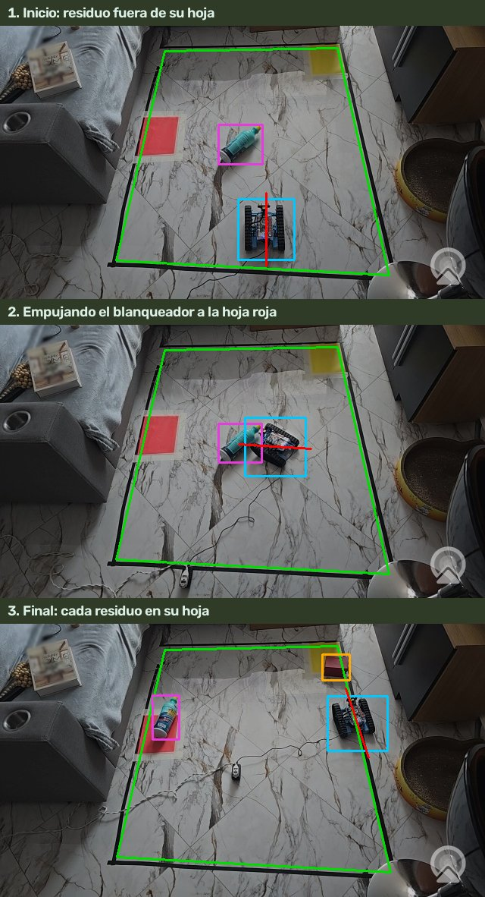
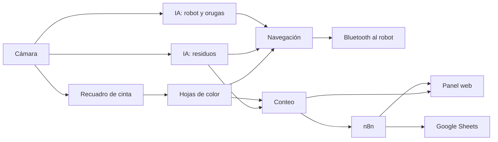
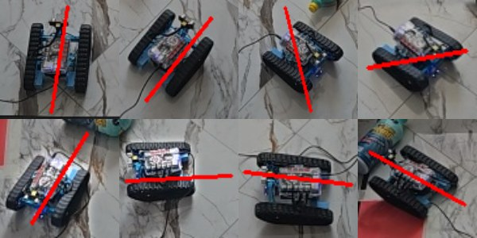
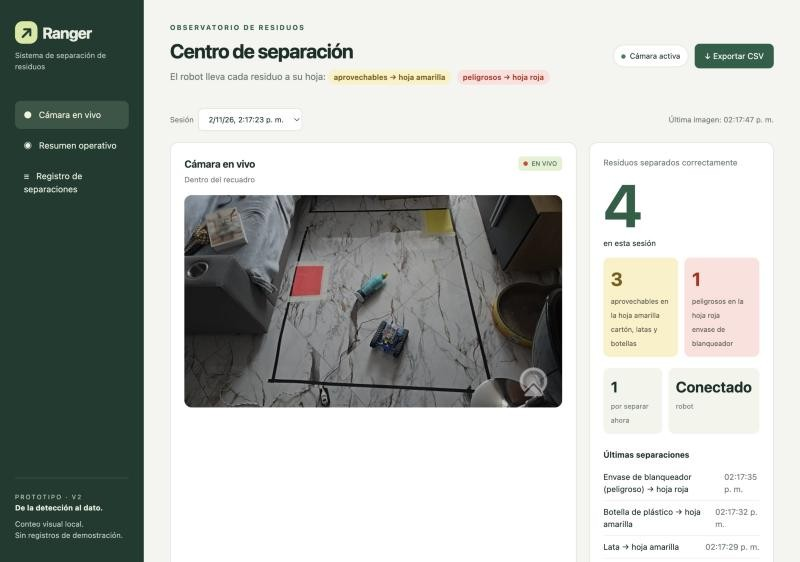
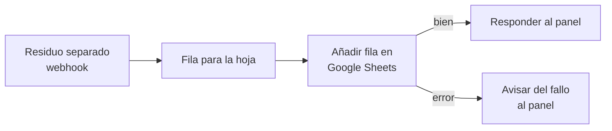
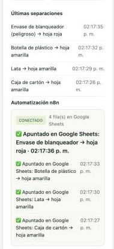

# Guía de estudio: mBot de residuos

**Actualizado: 2 de noviembre de 2026.** Esta guía es para estudiar el proyecto desde cero y poder exponerlo. Explica qué hace, cómo funciona por dentro paso a paso, qué se hizo y por qué, qué se midió y qué limitaciones tiene. No hace falta saber programar para seguirla: los términos técnicos se explican la primera vez que aparecen y hay un glosario al final.

> **Cómo leerla.** Si tienes poco tiempo, lee el apartado 1 (una página) y el 10 (preguntas del profesor). Para exponer bien, lee del 1 al 9 en orden. El apartado 11 propone cómo repartir la exposición entre varias personas.

---

## 1. El proyecto en una página

**Qué es.** Un prototipo de robot que **separa residuos de forma autónoma**. Una cámara mira una zona del suelo marcada con cinta negra. Dentro hay dos hojas de color y varios residuos. Un programa en el ordenador reconoce cada residuo y al robot, y el robot (un **mBot Ranger** con orugas) empuja cada residuo hasta la hoja que le corresponde:

| Hoja | Grupo | Residuos |
|---|---|---|
| **Amarilla** | Aprovechables (reciclables) | caja de cartón, lata, botella de vidrio, botella de plástico |
| **Roja** | Peligrosos | envase de blanqueador |

**Qué pasa en una demostración, en 5 pasos:**

1. La cámara (un teléfono Samsung usado como cámara web) ve la zona. El programa encuentra solo el **recuadro de cinta**, las **dos hojas**, los **residuos** y el **robot**.
2. Se pulsa **G** en el programa. El robot elige el residuo más cercano que no está en su hoja.
3. Se coloca detrás del residuo y lo **empuja hasta su hoja**. Si el residuo es peligroso, va a la roja; si es aprovechable, a la amarilla.
4. Cuando el residuo queda encima de su hoja, el **panel web** lo cuenta («Residuos separados correctamente: +1»).
5. Ese residuo se envía a **n8n** (una herramienta de automatización), que lo **apunta en una hoja de cálculo de Google Sheets** y **responde al panel** con un mensaje («✅ Apuntado en Google Sheets: Lata → hoja amarilla»).

El robot repite esto con cada residuo hasta que todos están en su hoja («Todo clasificado»).

**Lo más importante que hay que saber explicar:**

- La «inteligencia artificial» del proyecto son **detectores entrenados con fotos propias**: uno reconoce los 5 residuos y otro reconoce el robot.
- El robot no tiene GPS ni brújula: **todo se decide con la cámara cenital**, que mira desde arriba. El programa calcula dónde está cada cosa y hacia dónde mira el robot (por la dirección de sus orugas).
- El ordenador le manda al robot **órdenes cortas por Bluetooth** (avanza un poco, gira un poco, para), y vuelve a mirar después de cada una.
- La **seguridad** está por capas: si algo falla (se pierde la imagen, el recuadro o el robot), el robot se para.

*Imagen real de la prueba del 2 de noviembre. Verde: recuadro de cinta. Azul: robot. Línea roja: dirección de sus orugas. Rosa y naranja: residuos.*

---

## 2. Componentes

### 2.1 Hardware (lo físico)

| Componente | Para qué sirve |
|---|---|
| **mBot Ranger** (placa Auriga, chip ATmega2560) | Robot con orugas que empuja los residuos. Recibe órdenes por Bluetooth. |
| **Samsung Galaxy S24 Ultra** con la app **Camo** | Cámara cenital: mira la zona desde arriba y envía la imagen al Mac (1280 × 720, unos 30 fotogramas por segundo). |
| **MacBook con chip Apple M5** | Ejecuta todo el programa: visión, inteligencia artificial, navegación, panel y n8n. Usa la tarjeta gráfica (GPU) para la IA. |
| **Cinta negra** en el suelo | Marca la zona de trabajo (el «recuadro»). |
| **Hoja amarilla y hoja roja** | Destinos de los residuos: aprovechables y peligrosos. |
| **Residuos de prueba** | Caja de cartón roja, lata metálica, botella de vidrio pequeña, botella de plástico de agua y envase de blanqueador. |

### 2.2 Software (los programas)

| Pieza | Qué es | Dónde está |
|---|---|---|
| Programa principal | Une todo: cámara, visión, robot, conteo y panel | `outputs/vision_linea_robot.py` |
| Python 3.13 | Lenguaje en el que está escrito todo el programa del ordenador | `work/venv/` |
| OpenCV | Biblioteca de visión por ordenador: leer la cámara, buscar colores, líneas y formas | — |
| YOLO11n (Ultralytics) | Red neuronal que detecta objetos; la entrenamos con nuestras fotos | `outputs/models/*.pt` |
| Firmware del robot | Programa que corre dentro del mBot (en lenguaje Arduino) y obedece las letras que llegan por Bluetooth | `outputs/ranger_bluetooth.ino` |
| Panel web | Página que muestra la cámara en vivo y el conteo | `outputs/dashboard.py`, `outputs/dashboard/index.html` |
| n8n | Herramienta de automatización con bloques visuales; apunta cada residuo en Google Sheets | `outputs/n8n/` |
| Pruebas automáticas | 149 pruebas que comprueban el programa sin cámara ni robot | `tests/` |

---

## 3. Recorrido completo, paso a paso

Este es el corazón de la exposición: **qué pasa desde que la cámara toma una imagen hasta que aparece una fila en Google Sheets.** El programa repite este ciclo muchas veces por segundo.

<!-- figura: recorrido -->

### 3.1 La cámara

- El teléfono se conecta al Mac con la app **Camo** y el Mac lo ve como una cámara web normal.
- El programa elige solo la cámara externa. **Nunca usa la cámara del Mac**: fue una decisión del proyecto, porque no mira el suelo.
- Cada imagen llega en alta resolución. Para el análisis geométrico (cinta, hojas, posiciones) se usa una **copia reducida de 640 píxeles de ancho**, que es más rápida. Para la inteligencia artificial se usa la imagen original, con más detalle.
- Si la imagen deja de cambiar (por ejemplo, el teléfono se queda sin batería y Camo muestra su logo), el programa lo detecta y **para el robot**.

### 3.2 El recuadro de cinta

**Problema:** el programa tiene que saber dónde está la zona de trabajo, aunque haya sombras, poca luz o personas alrededor.

**Cómo lo encuentra** (archivo `vision_cinta.py`):

1. Busca píxeles **más oscuros que el suelo de alrededor** (no solo «negros»: así funciona también con poca luz).
2. Busca **líneas rectas** largas en esas zonas oscuras (técnica de Hough, explicada en el glosario).
3. Prueba combinaciones de cuatro rectas y se queda con las que forman un **cuadrilátero creíble**: esquinas entre 40° y 140°, tamaño razonable, la mayor parte de cada lado con cinta y **suelo claro a los dos lados de la cinta**. Esta última regla descarta los bordes de las sombras.
4. Lo da por **confirmado** cuando lo ve en el mismo sitio durante varias imágenes seguidas.

**Resultado medido:** en un banco de pruebas con 46 imágenes y 15 tipos de dificultad (oscuridad, sombras, reflejos, zapatos, una persona…), el método antiguo acertaba el **44,9 %** de las veces y el nuevo, el **99,6 %**.

**Idea clave: las «coordenadas del recuadro».** Como la cámara ve el suelo inclinado, el recuadro aparece deformado (más estrecho por arriba). El programa calcula una transformación matemática (una **homografía**) que «endereza» el recuadro y lo convierte en un cuadrado de 400 × 400 unidades, como un plano visto desde arriba. **Todas las posiciones del robot, los residuos y las hojas se miden en ese plano.** Así las distancias y los ángulos son reales, y si la cámara se mueve un poco, el recuadro se mueve con ella y las cuentas siguen bien.

### 3.3 Las hojas de color

**Cómo las encuentra** (archivo `vision_hojas.py`):

- Pasa la imagen al espacio de color **HSV** (tono, saturación, brillo), donde es fácil decir «esto es rojo» o «esto es amarillo».
- Busca manchas grandes, rectangulares y de color intenso dentro del recuadro.
- **Truco para no confundir la hoja roja con la caja roja:** tienen casi el mismo tono, pero la hoja (papel) es **casi tan clara como el suelo o más**, y la caja (cartón con sombra) es **bastante más oscura**.
- Si un residuo tumbado encima **parte la hoja en trozos**, los junta y la reconoce igual, siempre que entre los trozos no haya suelo.
- Una vez confirmadas, las hojas **se recuerdan** en el plano del recuadro, aunque el robot o un residuo las tape un rato.

### 3.4 Reconocer los residuos (inteligencia artificial)

- Se usa un **detector YOLO11n entrenado por nosotros** con fotos de nuestros 5 residuos (cómo se entrenó: apartado 5).
- Para cada imagen devuelve rectángulos con una etiqueta y una **confianza** (de 0 a 1). Un residuo nuevo solo aparece si la confianza llega a **0,5 en dos imágenes** (o a 0,6 en una). Así se evitan falsas alarmas.
- **Estabilidad:** un residuo no aparece y desaparece en cada imagen. El programa lo sigue en el tiempo y su nombre se decide **por votación** entre las últimas imágenes.
- **Regla de seguridad, «ante la duda, peligroso»:** si el detector duda entre botella de plástico y envase de blanqueador, se trata como **blanqueador**. Es peor mandar un químico al reciclaje que al revés.
- Se descartan las detecciones que caen encima del robot (el robot no es un residuo) y la marca de agua de Camo.

### 3.5 Reconocer el robot

- Otro **detector propio** (también YOLO11n), entrenado solo para encontrar el robot. En 74 de 74 imágenes de prueba lo encontró (el método anterior, sin entrenar, solo en 1 de 74).
- Entre detección y detección, el robot se **sigue** con un algoritmo llamado **CSRT**, que lo localiza imagen a imagen comparando su aspecto. Si el seguimiento se desvía, el detector lo corrige.
- Antes se probó a pegarle una etiqueta impresa (ArUco), pero se descartó: el robot se reconoce solo.

### 3.6 Saber hacia dónde mira el robot: las orugas

Este fue uno de los problemas más difíciles del proyecto.

**El problema:** el robot no tiene brújula. Antes, para saber hacia dónde miraba, el programa le hacía dar un **pasito de prueba** después de cada giro y medía hacia dónde se había movido. Pero el rectángulo del robot «tiembla» unos píxeles en la imagen, así que la medida tenía unos **±20° de error**. El siguiente giro se pasaba, había que corregir hacia el otro lado… El robot pasaba **el 60-65 % del tiempo girando o comprobando** y solo un 10-13 % empujando. Era lo que se veía como «vueltas sin sentido».

**La solución** (archivo `vision_orugas.py`): mirar las **orugas** en la imagen. Son dos franjas negras paralelas a los lados del robot, así que su dirección es la dirección del robot.

1. Se recorta el robot y se marcan sus píxeles oscuros.
2. Se «gira» esa máscara en muchos ángulos y, para cada ángulo, se suma lo oscuro por filas.
3. En la dirección de las orugas aparecen dos picos muy marcados, uno por cada oruga. El ángulo con los picos más marcados es la dirección del robot.

**Resultado:** comparado con hacia dónde se movió de verdad el robot en 88 tramos rectos grabados, el **error típico es de 5°** (antes, unos 20°). Tarda 4-10 milésimas de segundo. Las orugas dan la dirección pero no el sentido (adelante o atrás), así que el programa elige el sentido más parecido a lo que ya sabía. Si la medida no cuadra con el giro que acaba de hacer, la descarta.

### 3.7 La navegación: decidir y mover

Archivo `navegacion.py`. Funciona por **pasos cortos**: decidir, dar una orden corta, esperar a que el robot se quede quieto, mirar dónde quedó y volver a decidir.

1. **Elegir residuo:** el más cercano que esté dentro del recuadro y **no esté ya en su hoja**. Se prefieren los que tienen el camino libre.
2. **Colocarse detrás:** se calcula la línea que va del residuo al centro de su hoja, y el robot se pone detrás del residuo en esa línea. Si el camino pasa por encima del residuo, lo rodea.
3. **Empujar:** avanza hacia el centro de la hoja con el residuo delante, corrigiendo el rumbo con pequeños giros.
4. **Dejarlo:** cuando el residuo está sobre su hoja (su centro encima o al menos el **40 %** de él pisándola), retrocede un poco y vuelve al paso 1.
5. **Terminar:** cuando no quedan residuos fuera de su hoja, da un paso atrás (por si tenía una lata debajo) y muestra **«Todo clasificado»**.

**Situaciones especiales que también resuelve:**

- **Se sube encima de una lata.** Las orugas trepan por las latas tumbadas. Si el residuo aparece detrás del robot, este retrocede, gira y lo intenta desde otro ángulo.
- **El residuo resbala a un lado** mientras lo empuja: vuelve a colocarse detrás.
- **Se sale del recuadro:** no se para (eso obligaba a ir a buscarlo); vuelve solo hacia el centro.
- **Un residuo imposible:** tras 3 intentos o 2 minutos, lo deja un minuto y sigue con otros.
- **El robot tapa el residuo** al empujarlo: solo lo da por dejado si la última vez que lo vio ya estaba junto a su hoja; si no, retrocede un paso para volver a verlo.

### 3.8 Las órdenes al robot (Bluetooth y firmware)

- El ordenador habla con el robot por **Bluetooth de baja energía (BLE)**. Le manda **una letra** por orden:

| Letra | Orden |
|---|---|
| `w` / `s` | avanzar / retroceder |
| `a` / `d` | girar a la izquierda / a la derecha |
| `x` | parar |
| `p` | pitido (sin parar los motores) |
| `0`–`3` | luces (durante la visión van apagadas: alteraban el seguimiento) |
| `?` | preguntar la versión del firmware |

- El robot contesta a cada orden con una confirmación.
- **Temporizador de seguridad en el firmware:** si en **600 milésimas de segundo** no llega otra orden de movimiento, el robot **para solo**. Así, si el ordenador se cuelga o se corta el Bluetooth, el robot no sigue avanzando.
- El firmware se carga en el robot por **USB** con `outputs/actualizar_ranger.py`, y el programa comprueba que la versión sea la correcta antes de mover nada.

### 3.9 El conteo de residuos separados

Archivo `conteo_residuos.py`. **Cuándo cuenta un residuo:** cuando lo ve **sobre su hoja** habiéndolo visto antes **fuera de ella**. Lo confirma con dos observaciones en al menos 0,35 segundos, o con una sola si nada la contradice durante un segundo.

**Detalles que evitan errores:**

- Las posiciones se comparan en las **coordenadas del recuadro**, así que da igual que la cámara se mueva un poco.
- Cada residuo tiene una «identidad» que se sigue en el tiempo. Cuando el robot lo tapa al empujarlo y reaparece, el programa sabe que es el mismo.
- Si alguien **quita un residuo de su hoja** y lo vuelve a dejar más tarde, **cuenta otra vez**. Si solo «parpadea» en el borde mientras el robot lo empuja, no cuenta doble.
- Si dejas un residuo directamente en su hoja sin que haya estado fuera, no cuenta: no se ha separado.
- Los datos se guardan en una pequeña base de datos local, **SQLite** (`work/estadisticas.sqlite3`).

### 3.10 El panel web

- Se abre en el navegador en **http://127.0.0.1:8765**. Solo es accesible desde el mismo ordenador.
- Muestra la **cámara en vivo** con las marcas, el **total de residuos separados** en grande, cuántos van a la hoja amarilla y cuántos a la roja, cuántos quedan por separar, si el robot está conectado y las últimas separaciones.
- Al contar un residuo aparece un aviso «+1» sobre la imagen.
- Tiene un apartado **«Automatización n8n»** con las respuestas de n8n.
- Permite **exportar** los datos a CSV y ver sesiones anteriores.

### 3.11 n8n y Google Sheets

**Qué es n8n:** una herramienta para crear automatizaciones uniendo **bloques** («nodos») con flechas, sin escribir programas largos. Aquí corre en el mismo Mac (http://localhost:5678).

**El flujo** (está en `outputs/n8n/registro_residuos.json`) tiene 5 nodos:

<!-- figura: n8n -->

1. **Residuo separado (webhook):** una dirección web que espera avisos. El programa del robot le envía cada residuo contado: fecha, hora, residuo, hoja, grupo, confianza, sesión y total.
2. **Fila para la hoja:** ordena esos datos con los títulos de las columnas.
3. **Añadir fila en Google Sheets:** escribe la fila en la hoja de cálculo «Residuos separados – mBot».
4. **Responder al panel:** contesta al programa «✅ Apuntado en Google Sheets: Lata → hoja amarilla». El panel muestra ese mensaje.
5. **Avisar del fallo al panel:** si Google falla (sin internet, sin permiso…), contesta con el motivo y el panel lo muestra.

**Diseño robusto:** el envío va «aparte», en otro hilo del programa, así que **el robot nunca espera a internet**. Si n8n está cerrado, los avisos esperan en fila y se mandan cuando se abre. Solo se envían datos del conteo, **nunca imágenes**.

---

## 4. Seguridad

El robot se mueve solo, así que la seguridad está pensada por capas:

1. **Parada manual:** la tecla **Espacio** (o `x`) para el robot al instante.
2. **Hay que habilitarlo:** el robot no se mueve hasta que se pulsa **E**, y con **G** empieza el automático.
3. **Imagen reciente:** si la imagen llega con retraso, se congela o desaparece, el robot se para.
4. **Recuadro perdido:** si el programa deja de ver el recuadro, el robot **se deshabilita** y hay que volver a pulsar E y G.
5. **Robot perdido:** si no se ve el robot, el automático se detiene.
6. **Temporizador del firmware:** sin órdenes durante 600 ms, los motores paran solos.
7. **Pasos cortos:** cada orden dura décimas de segundo, nunca un movimiento largo a ciegas.
8. **Bluetooth:** un retraso suelto en la confirmación no corta la conexión, pero tres seguidos sí, y el robot para.

---

## 5. Cómo se entrenó la inteligencia artificial

**Por qué entrenar un detector propio:** los detectores generales, entrenados con millones de fotos de internet, confundían nuestros residuos. Por ejemplo, la caja roja se perdía y la lata se veía solo un 21 % de las veces. Un detector pequeño entrenado con **nuestros objetos, nuestra cámara y nuestro suelo** es mucho más fiable.

**Pasos que se siguieron:**

1. **Recoger fotos:** con `recoger_imagenes.py`, cientos de fotos desde la cámara de trabajo, con los residuos mezclados, movidos, sobre las hojas, junto al robot y con poca luz.
2. **Preetiquetar:** otros modelos (Grounding DINO y CLIP, que entienden texto como «a turquoise bleach bottle») y reglas de color (turquesa = blanqueador, etiqueta azul = agua) propusieron los rectángulos.
3. **Revisar a mano:** se revisaron todos los recortes en hojas numeradas y se corrigieron unos 70 errores. Con un modelo provisional se encontraron unos 165 residuos sin etiquetar, y 65 blanqueadores más buscando su color turquesa.
4. **Separar fotos de prueba:** una parte de las fotos **no se usa para aprender**, para medir con imágenes que el modelo nunca vio.
5. **Entrenar:** YOLO11n, 35 rondas («épocas»), con 959 fotos para aprender.
6. **Evaluar residuo por residuo** con las fotos de prueba.

**Resultados con fotos no vistas** (porcentaje de residuos encontrados con la etiqueta correcta):

| Residuo | Antes (detector anterior) | Ahora |
|---|---|---|
| Caja de cartón | 88 % | **100 %** |
| Lata | 23 % | **82 %** |
| Botella de vidrio | 0 % | **72-88 %** |
| Botella de plástico | 0 % | **89 %** |
| Envase de blanqueador | 0 % | **96-99 %** |

- **Ninguna confusión** entre botella de plástico y blanqueador en las fotos de prueba.
- Detecciones falsas: 0,04-0,24 por foto (antes 0,54).
- El detector del robot se entrenó igual: 591 fotos, y acertó 74 de 74 en fotos de prueba.

---

## 6. Historia del proyecto: qué se hizo y por qué

| Fecha (2026) | Qué se hizo | Por qué |
|---|---|---|
| Hasta el 19/10 | Primera versión: cámara LifeCam, detectores generales de residuos, control manual del robot por Bluetooth, firmware V2 con temporizador de seguridad, primer panel web | Base del proyecto: ver residuos y mover el robot a mano |
| 26/10 | Cámara Samsung con Camo; primer detector propio (caja, envoltura, papel) | La LifeCam tenía poca resolución; los detectores generales fallaban |
| 27/10 | Firmware V2 cargado en el robot; detector de cinta robusto; robot encontrado sin etiqueta; tecla **G**: primera prueba física: **el robot llegó al residuo y lo sacó del recuadro** | Dar autonomía al robot |
| 28/10 | Detector propio del robot; detector propio de caja y lata; panel con cámara en vivo; conteo rehecho; empuje en línea recta; el robot ya no se para al salir del recuadro; se despega si se sube a una lata | Las pruebas físicas mostraron fallos de seguimiento, conteo y vueltas |
| 29/10 | 4.ª prueba física: 5 residuos sacados y contados | Comprobar los arreglos |
| 1/11 | **Hojas de color** como destino; destinos finales: amarilla = aprovechables, roja = peligrosos; detector de **5 residuos**; regla «ante la duda, peligroso» | Pasar de «sacar del recuadro» a **clasificar** |
| 2/11 | Pruebas en vivo de las 5 clases; arreglos de conteo y Bluetooth; **dirección por las orugas** (adiós a las vueltas); **n8n + Google Sheets** con respuesta al panel | Dejarlo listo para la exposición |

**Lecciones que vale la pena contar:**

- **Medir antes de cambiar.** Las «vueltas» no se arreglaron a ojo: se midió en las grabaciones que el 60 % del tiempo se iba en girar y comprobar, y se buscó la causa (rumbo mal medido).
- **No todo cambio mejora.** Un ajuste de parámetros que mejoraba en la simulación empeoró en la prueba real y **se deshizo**. Las pruebas físicas mandan.
- **Los datos propios valen más que un modelo grande.** El salto de la lata del 23 % al 82 % vino de etiquetar bien nuestras fotos.

---

## 7. Resultados medidos

| Qué | Resultado | Cómo se midió |
|---|---|---|
| Recuadro de cinta en condiciones difíciles | 99,6 % de aciertos (antes 44,9 %) | 46 imágenes × 15 tipos de dificultad |
| Detector de residuos (fotos no vistas) | Caja 100 %, lata 82 %, vidrio 72-88 %, plástico 89 %, blanqueador 96-99 % | 80 fotos de prueba |
| Detector del robot | 74 de 74 | 83 fotos de prueba |
| Dirección por las orugas | Error típico de 5° (antes ~20°) | 88 tramos rectos grabados |
| Llevar el blanqueador a su hoja | ~13 segundos, sin vueltas | Prueba física del 2/11 |
| Navegación en simulación | 56 de 60 escenas con los dos residuos en su hoja; 30 s de mediana | 60 escenas al azar con ruido y retrasos |
| n8n | Responde en ~2-2,5 s tras escribir en Google Sheets | Prueba física del 2/11 |
| Pruebas automáticas | 149, todas correctas | `python -m unittest discover -s tests` |

**Ojo al exponer:** distingue entre *probado físicamente* (con el robot real), *probado en simulación* (un robot imaginario en el ordenador) y solo *implementado*. Esta guía lo indica siempre.

---

## 8. Limitaciones y trabajo futuro

Es un **prototipo**: funciona, pero tiene límites conocidos. Reconocerlos da credibilidad.

- **Residuos pegados a la cinta:** para colocarse detrás, el robot tendría que salir del recuadro y puede perderse de vista. *Mejora posible:* empujar primero el residuo hacia dentro.
- **Todavía gira bastante** para colocarse detrás de cada residuo, aunque mucho menos que antes.
- **La botella de vidrio** se reconoce peor que el resto. Se decidió no seguir mejorándola.
- **Hoja amarilla pequeña:** un residuo puede empujar a otro fuera. En la demostración, se retira cada residuo en cuanto se cuenta.
- **Solo funciona en Mac** (usa la cámara a través de AVFoundation, de Apple).
- **Depende de la luz y del montaje** de la cámara: tiene que ver el recuadro entero y quieto.
- **Empuja, no recoge:** no tiene pinza; recoger con pinza y calcular la ruta óptima serían el siguiente paso.

---

## 9. Cómo hacer la demostración (lista de comprobación)

**Antes de empezar:**

1. Teléfono **cargando**, con Camo abierto y la **cámara trasera**, fijo y mirando el recuadro entero desde arriba.
2. Recuadro de cinta en el suelo; **hoja amarilla y roja dentro**; residuos dentro, **fuera de sus hojas** y separados de la cinta (un largo de robot).
3. Robot **en el suelo**, encendido, con baterías y sin cable tirante.
4. Abrir **n8n**: doble clic en `outputs/n8n/Abrir_n8n.command` y comprobar http://localhost:5678.
5. Abrir el **programa**: doble clic en `outputs/Probar_Robot_Linea.command`.
6. Abrir el **panel** en el navegador: http://127.0.0.1:8765.

**Durante la demostración:**

1. Comprobar en la ventana del programa que se ven el recuadro verde, las dos hojas, el robot y los residuos.
2. Pulsar **C** (conectar por Bluetooth). Esperar «Bluetooth conectado».
3. Pulsar **E** (habilitar) y **G** (empezar a separar).
4. Tener el dedo en **Espacio** para parar si hace falta.
5. Mostrar en el panel el **+1** y la respuesta de n8n, y en Google Sheets la **fila nueva**.

**Si algo falla:**

| Síntoma | Solución |
|---|---|
| «Recuadro perdido» y el robot se para | Que nadie tape la cinta; pulsar **E** y **G** |
| «Bluetooth detenido» | Acercar el robot; pulsar **C**, **E**, **G** |
| No ve el robot | Que esté entero dentro del recuadro; si no, **R** para marcarlo con el ratón |
| El robot da vueltas junto a la cinta | Parar con Espacio y separar el residuo de la cinta |
| El panel dice «n8n sin respuesta» | Abrir n8n; los avisos pendientes se envían solos |
| Imagen negra con logo de Camo | El teléfono se apagó o Camo se cerró |

**Teclas del programa:** `C` conectar · `E` habilitar · `G` separar residuos · `Espacio`/`X` parar · `W A S D` mover a mano · `R` marcar el robot · `T` reiniciar cinta · `N` reiniciar todo · `B` confirmar recuadro · `+ − 0` zoom · `Q` salir.

---

## 10. Preguntas que puede hacer el profesor

**¿Dónde está la inteligencia artificial?**
En dos detectores de objetos (redes neuronales YOLO11n) que **entrenamos con nuestras propias fotos**: uno reconoce los 5 residuos y otro, el robot. Para preparar las fotos también se usaron modelos que entienden texto (Grounding DINO y CLIP). El resto (recuadro, hojas, orugas, navegación) es visión por ordenador clásica y lógica programada.

**¿Por qué no usar un detector ya hecho?**
Porque fallaba con nuestros objetos: la lata se veía un 21-23 % de las veces y la botella de plástico o el blanqueador, nunca. Con fotos propias, el detector pasó a 82-100 % según el residuo.

**¿Cómo sabe el robot dónde está y hacia dónde mira?**
No lo sabe el robot: lo sabe el ordenador mirando desde arriba. La posición sale del detector del robot; la dirección, de sus **orugas** en la imagen. Todo se mide en el plano del recuadro, que se obtiene «enderezando» la imagen con una homografía.

**¿Y si confunde el blanqueador con la botella de plástico?**
Hay una regla: **ante la duda, peligroso**. Si el detector duda entre los dos, lo trata como blanqueador y lo lleva a la hoja roja. En las fotos de prueba no hubo ninguna confusión entre ellos.

**¿Qué pasa si se pierde la conexión o la imagen?**
El robot se para. El firmware tiene un temporizador que detiene los motores si no recibe órdenes en 600 ms, y el programa para el robot si la imagen se atrasa o deja de ver el recuadro o el robot.

**¿Para qué sirve n8n?**
Para **automatizar el registro**: cada residuo separado queda apuntado en Google Sheets con fecha, hora, tipo, hoja y confianza, sin intervención humana. Además n8n responde al panel, que muestra la confirmación. Si n8n está cerrado, el robot sigue funcionando y los avisos se envían después.

**¿Cuánto acierta?**
Ver el apartado 7. Lo más vistoso: el detector de residuos acierta del 82 al 100 % según el residuo en fotos que nunca vio, y el robot llevó el blanqueador a su hoja en unos 13 segundos.

**¿Qué no funciona todavía?**
Ver el apartado 8: residuos pegados a la cinta, todavía algo de giro para colocarse, la botella de vidrio y que solo funciona en Mac.

**¿Cómo sabéis que el programa funciona bien?**
Además de las pruebas físicas, hay **149 pruebas automáticas** que comprueban cada parte sin cámara ni robot. También hay una **simulación** de la navegación con un robot imaginario, que se usó para comparar cambios antes de probarlos con el real.

**¿Por qué el robot da pasos cortos y no va directo?**
Porque cada paso se comprueba con la cámara. Si algo se mueve o el robot resbala, se corrige en el siguiente paso. Es más seguro que un movimiento largo a ciegas.

---

## 11. Cómo repartir la exposición (propuesta)

| Persona | Parte | Apartados de esta guía |
|---|---|---|
| 1 | El problema, la idea y la demostración | 1, 2 y 9 |
| 2 | Visión: recuadro, hojas y coordenadas del recuadro | 3.1, 3.2 y 3.3 |
| 3 | Inteligencia artificial: residuos, robot y entrenamiento | 3.4, 3.5 y 5 |
| 4 | Navegación, orugas, Bluetooth y seguridad | 3.6, 3.7, 3.8 y 4 |
| 5 | Conteo, panel y automatización con n8n | 3.9, 3.10 y 3.11 |
| Todos | Resultados, limitaciones e historia | 6, 7 y 8 |

---

## 12. Glosario

- **Algoritmo:** receta de pasos que sigue el programa.
- **BLE (Bluetooth de baja energía):** forma de Bluetooth que usa el robot para recibir órdenes.
- **Confianza:** número de 0 a 1 con el que el detector dice lo seguro que está de lo que ve.
- **CSRT:** algoritmo de seguimiento: localiza un objeto en cada imagen nueva comparándolo con cómo se veía antes.
- **Detector de objetos:** programa de IA que, dada una imagen, devuelve rectángulos con el nombre de cada objeto.
- **Entrenar:** enseñar a una red neuronal con ejemplos (fotos con sus rectángulos y nombres) para que aprenda a reconocerlos.
- **Etiquetar:** marcar en cada foto dónde está cada objeto y qué es.
- **Época:** una vuelta completa del entrenamiento sobre todas las fotos.
- **Firmware:** programa que corre dentro del robot.
- **Fotos de prueba:** fotos que el modelo no ve al aprender; sirven para medir si de verdad generaliza.
- **GPU:** procesador gráfico; hace muy rápido los cálculos de la IA.
- **Homografía:** transformación matemática que convierte la vista inclinada del suelo en un plano visto desde arriba.
- **Hough (transformada de):** técnica para encontrar líneas rectas en una imagen.
- **HSV:** forma de describir colores por tono (qué color), saturación (cuán intenso) y brillo.
- **MJPEG:** vídeo hecho de imágenes JPEG seguidas; así se ve la cámara en el panel.
- **n8n:** herramienta de automatización con bloques visuales (nodos) unidos por flechas.
- **Nodo (en n8n):** cada bloque de una automatización; hace una tarea (recibir, transformar, escribir, responder).
- **OpenCV:** biblioteca de visión por ordenador.
- **Red neuronal:** modelo matemático inspirado en las neuronas que aprende a partir de ejemplos.
- **Simulación:** robot y residuos imaginarios dentro del ordenador para probar la navegación sin riesgo.
- **SQLite:** base de datos sencilla guardada en un archivo.
- **Webhook:** dirección web que espera avisos; cuando llega uno, n8n arranca la automatización.
- **YOLO (You Only Look Once):** familia de detectores de objetos rápidos; usamos la versión pequeña YOLO11n.

---

## 13. Mapa de archivos

| Archivo | Qué hace |
|---|---|
| `outputs/vision_linea_robot.py` | Programa principal: cámara, visión, robot, conteo y panel |
| `outputs/vision_cinta.py` | Encuentra el recuadro de cinta |
| `outputs/vision_hojas.py` | Encuentra las hojas de color y define qué residuo va a cada una |
| `outputs/vision_ranger.py` | Cámara, detectores de residuos y del robot, Bluetooth |
| `outputs/vision_residuos.py` | Estabilidad de las detecciones y regla «ante la duda, peligroso» |
| `outputs/vision_orugas.py` | Dirección del robot por sus orugas |
| `outputs/navegacion.py` | Decide los movimientos del robot |
| `outputs/conteo_residuos.py` | Cuenta los residuos separados y los guarda |
| `outputs/dashboard.py`, `outputs/dashboard/index.html` | Panel web |
| `outputs/aviso_n8n.py` | Envía cada residuo a n8n y guarda su respuesta |
| `outputs/n8n/registro_residuos.json` | El flujo de n8n (se importa en n8n) |
| `outputs/n8n/Abrir_n8n.command` | Abre n8n en el Mac |
| `outputs/ranger_bluetooth.ino` | Firmware del robot |
| `outputs/actualizar_ranger.py` | Carga el firmware en el robot por USB |
| `outputs/recoger_imagenes.py`, `outputs/entrenar_detector.py` | Recoger fotos y entrenar el detector |
| `outputs/Probar_Robot_Linea.command` | Abre el programa principal con doble clic |
| `tests/` | Pruebas automáticas |

**Para profundizar:** [Manual de uso](USO.md) · [Instalación](INSTALACION.md) · [Arquitectura](ARQUITECTURA.md) · [Robot y Bluetooth](ROBOT.md) · [Entrenamiento](ENTRENAMIENTO.md) · [n8n](N8N.md) · [Estado](ESTADO.md) · [Problemas conocidos](PROBLEMAS.md)
