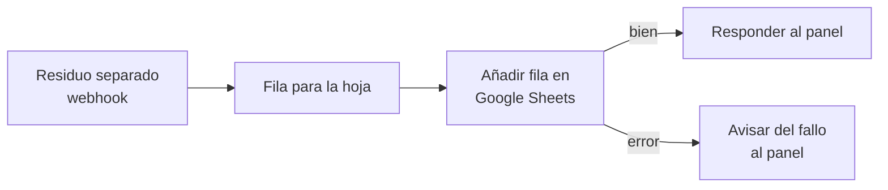

# Automatización con n8n: registrar cada residuo en Google Sheets

**Actualizado: 2 de noviembre de 2026.** Si empiezas desde cero, lee primero la [guía de estudio](GUIA_DE_ESTUDIO.md) (apartado 3.11).

## Qué hace

Cada vez que el panel cuenta un residuo separado (un residuo que llega a su hoja de color):

1. El programa del robot lo envía a **n8n**.
2. n8n escribe una **fila** en la hoja de cálculo de Google Sheets «Residuos separados – mBot».
3. n8n **responde** al programa con un mensaje, y el panel lo muestra en el apartado «Automatización n8n», por ejemplo: «✅ Apuntado en Google Sheets: Lata → hoja amarilla».

Columnas de cada fila: **Fecha · Hora · Residuo · Hoja · Grupo · Confianza · Sesión · Total en la sesión**.

## El flujo

Archivo: `outputs/n8n/registro_residuos.json`.

<!-- figura: n8n -->


| Nodo | Tipo en n8n | Qué hace |
|---|---|---|
| Residuo separado | Webhook (POST `/webhook/residuos`, responde con «Respond to Webhook») | Recibe el aviso del programa |
| Fila para la hoja | Edit Fields (Set) | Pone los datos con los títulos de las columnas |
| Añadir fila en Google Sheets | Google Sheets → **Append Row**, **Map Automatically** | Escribe la fila; si falla, sigue por la salida de error |
| Responder al panel | Respond to Webhook | `{ok: true, mensaje: "✅ Apuntado en Google Sheets: …"}` |
| Avisar del fallo al panel | Respond to Webhook | `{ok: false, mensaje: "⚠️ n8n no pudo apuntarlo…: motivo"}` |

## Cómo lo usa el programa

- Archivo `outputs/aviso_n8n.py`. El envío va en un **hilo aparte**: el robot nunca espera a la red.
- Si n8n está cerrado, los avisos esperan en orden (hasta 500) y se reintentan cada 5 segundos.
- Si n8n contesta con un error, se reintenta como mucho 3 veces y se avisa en el panel. No se reintenta indefinidamente, para no duplicar filas.
- Solo se envían datos del conteo. **Nunca se envían imágenes.**
- Opciones del programa principal: `--n8n URL` (otra dirección de webhook; por defecto `http://localhost:5678/webhook/residuos`) y `--sin-n8n` (desactivarlo).

## Instalación (una sola vez)

n8n está instalado **en el Mac**, dentro de `work/n8n`. Esa carpeta no se sube a GitHub. Para instalarlo en otro Mac (hace falta Node.js 24 o más nuevo):

```sh
mkdir -p work/n8n && cd work/n8n
echo '{"name":"n8n-local","private":true}' > package.json
npm install n8n@2.45.7
```

## Abrir n8n

Doble clic en `outputs/n8n/Abrir_n8n.command`. Se abre una ventana de Terminal; no la cierres. Después entra en **http://localhost:5678**. Para cerrar n8n, pulsa Ctrl + C en esa ventana.

El lanzador hace que n8n **solo acepte conexiones desde el mismo Mac**. También quita la «cookie segura», porque Safari no la acepta en `http://localhost`.

## Configuración (una sola vez, la hace el dueño de la cuenta de Google)

1. **Usuario de n8n:** en «Set up owner account», escribe correo, nombre y una contraseña (mínimo 8 caracteres, con un número y una mayúscula). Este usuario solo existe en ese Mac.
2. **Importar el flujo:** en n8n, *Create workflow → menú ⋯ → Import from File* y elige `outputs/n8n/registro_residuos.json`.
3. **Credenciales de Google** en https://console.cloud.google.com:
   1. Crea un proyecto, por ejemplo «mBot residuos».
   2. En *APIs y servicios → Biblioteca*, habilita **Google Sheets API** y **Google Drive API**.
   3. En *Pantalla de consentimiento de OAuth*, elige tipo **Externo**, pon un nombre de app y **añade tu correo como usuario de prueba**.
   4. En *Credenciales → Crear credenciales → ID de cliente de OAuth*, elige tipo **Aplicación web** y como URI de redireccionamiento `http://localhost:5678/rest/oauth2-credential/callback`.
   5. Copia el **ID de cliente** y el **Secreto del cliente**.
4. **Hoja de cálculo:** crea en Google Drive una hoja con esta primera fila: `Fecha | Hora | Residuo | Hoja | Grupo | Confianza | Sesión | Total en la sesión`.
5. **Conectar Google en n8n:** abre el nodo «Añadir fila en Google Sheets». En *Credential*, crea una nueva de tipo «Google Sheets OAuth2 API», pega el ID y el secreto, pulsa *Sign in with Google* y permite el acceso. Si Google avisa de que la app no está verificada, pulsa *Continuar*: la app es tuya.
6. **En el mismo nodo**, comprueba:
   - **Operation: Append Row.** Al elegir la hoja, a veces vuelve sola a «Get Row(s)», que **lee en vez de escribir**: la ejecución sale «correcta» pero no apunta nada.
   - **Document** y **Sheet:** tu hoja.
   - **Mapping Column Mode: Map Automatically.** Con «Map Each Column Manually» y sin valores falla con «At least one value has to be added under 'Values to Send'».
7. **Guardar** (Cmd + S) y pulsar **Publish**, arriba a la derecha. En esta versión de n8n, **cada cambio hay que volver a publicarlo**. Si no, el programa recibe «webhook not registered».

## Comprobar que funciona

- En n8n, la pestaña **Executions** muestra cada aviso recibido. En verde quiere decir que se escribió la fila.
- En el panel (http://127.0.0.1:8765), el apartado «Automatización n8n» debe decir **CONECTADO** y mostrar los mensajes.
- Prueba sin robot (desde la carpeta del proyecto, con n8n abierto):

```sh
curl -s -X POST http://localhost:5678/webhook/residuos -H 'Content-Type: application/json' \
  -d '{"fecha":"2026-11-02","hora":"12:00:00","residuo":"PRUEBA","hoja":"amarilla","grupo":"aprovechables","confianza":0.9,"sesion":"prueba","total_sesion":0}'
```

Debe responder `{"ok":true,"mensaje":"✅ Apuntado en Google Sheets: PRUEBA → hoja amarilla",…}` y aparecer la fila en la hoja.

## Problemas frecuentes

| Síntoma | Causa | Solución |
|---|---|---|
| Safari no abre n8n | Cookie segura en `http://localhost` | Abrir n8n con `Abrir_n8n.command` (ya la desactiva) |
| «webhook "POST residuos" is not registered» | El flujo no está publicado | Pulsar **Publish** |
| La ejecución sale bien pero no aparece la fila | El nodo está en «Get Row(s)» | Cambiar a **Append Row**, guardar y publicar |
| «At least one value has to be added…» | Mapeo manual sin valores | **Map Automatically**, guardar y publicar |
| El panel dice «SIN RESPUESTA» | n8n cerrado | Abrir n8n; los avisos pendientes se envían solos |
