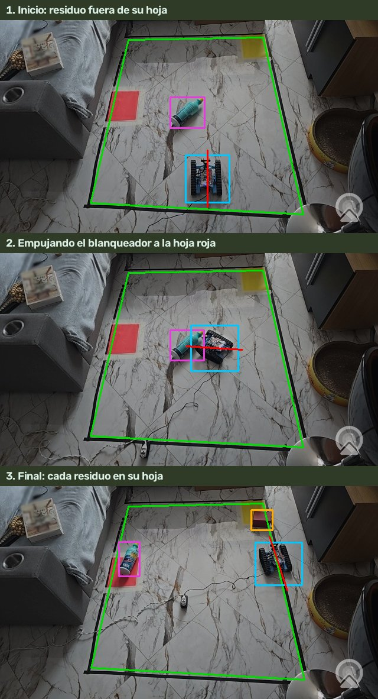

# Operación: firmware, seguridad, modo automático y conteo

Actualizado: 2 de noviembre de 2026

Documento principal: [Documentación técnica del sistema](DOCUMENTACION_TECNICA.md).

[Inicio](../README.md) · [Uso](USO.md) · [Robot y Bluetooth](ROBOT.md) · [Estado](ESTADO.md)

El [Manual de uso](USO.md) dice **qué teclas pulsar**. Este documento explica **qué hace el sistema por dentro** cuando las pulsas: el programa de la placa del robot, las reglas de seguridad, cómo decide el robot en el modo automático y cuándo se cuenta un residuo. El nombre del archivo viene de la «versión 2» del firmware (19 de octubre), con la que empezó este modo de trabajo.

## Firmware V2: qué es y cómo se carga

El **firmware** es el programa que vive en la placa Auriga del mBot Ranger. El nuestro (`outputs/ranger_bluetooth.ino`) obedece letras que llegan por Bluetooth:

| Letra | Qué hace |
|---|---|
| `w` `s` `a` `d` | Adelante, atrás, girar a la izquierda, girar a la derecha (potencia fija). |
| `x` | Parar los motores. |
| `p` | Pitido corto **sin parar los motores**. |
| `0` `1` `2` `3` | LED apagados, rojos, verdes o azules. |
| `?` | Responde su versión: `RANGER_READY_V2_20261019`. |

Si pasan **600 ms sin una letra de movimiento**, la placa para los motores por su cuenta (y responde `AUTO_STOP`). Así, si el Mac se cuelga o se corta el Bluetooth, el robot no sigue andando. Arranca con los LED apagados y sin pitar. No lee el sensor de línea.

**Estado:** cargado en el robot el 27/10 (sustituyó, con permiso de Juan, un programa de «control por aplausos» cuyo código no estaba en el Mac). Solo hay que volver a cargarlo si alguien restaura el programa de fábrica o carga otro con mBlock.

Para cargarlo:

1. Cierra mBlock y cualquier programa que use el robot.
2. Abre `outputs/Actualizar_Ranger.command`. Espera a que pida el cable.
3. Conecta el robot al Mac por USB. El programa reconoce la placa, compila el firmware, lo carga y comprueba la versión.
4. No desconectes el cable hasta leer `Actualización verificada: RANGER_READY_V2_20261019`.

Desde Terminal es lo mismo:

```sh
work/venv/bin/python outputs/actualizar_ranger.py --esperar
```

- Con varios puertos USB, indica el del robot: `--puerto /dev/cu.usbserial-1120` (es el que tenía en el Mac de Juan; compruébalo).
- Si la placa no responde como nuestro receptor (programa de fábrica u otro), la carga automática se niega. Tras comprobar que el puerto es el del robot: `--puerto ... --carga-inicial`.
- Tras abrir el puerto USB, la placa tarda unos 3 s en arrancar.
- La compilación usa las herramientas de la placa que instala **mBlock** en el Mac (`--toolchain RUTA` para otras). No está probada en Windows ni Linux.
- **Por Bluetooth no se puede cargar el firmware.** Si el programa encuentra una versión antigua por Bluetooth, pide el cable en vez de mover el robot.

## Seguridad: cuándo se para el robot

El robot se mueve a **pasos cortos**: cada orden dura como mucho unas décimas de segundo y hay que renovarla. Si algo falla, basta con dejar de enviar órdenes. Estas son todas las paradas:

| Situación | Qué pasa | Para seguir |
|---|---|---|
| Espacio o `x` | Para y deshabilita el movimiento. Apaga el modo automático. | `E` y `G` |
| Recuadro perdido o no visible («Borde conservado»), o imagen con más de 0,3 s de retraso | Para y **deshabilita** (a propósito: sin una imagen reciente del recuadro, el robot no sabe dónde está). Mensaje: «Recuadro perdido o imagen atrasada». | `E` y `G` |
| Seguimiento del robot perdido | Para. El detector lo busca de nuevo. | `E` y `G` cuando vuelva la caja azul |
| Imagen congelada 0,6 s con el robot en marcha (Camo sin teléfono) | Para y deshabilita. | Revisa la cámara; `E` y `G` |
| Bluetooth: 3 confirmaciones seguidas tardan más de 0,45 s | Cierra la conexión (una o dos lentas se toleran). | `C`, `E` y `G` |
| Cualquier tecla `t`, `n`, `b`, `r` o un paso manual | Para el automático (y `t`, `n`, `b`, `r` deshabilitan). | `E` y `G` |
| La placa no recibe letras en 600 ms | El firmware para los motores. | Automático al llegar nuevas órdenes. |

Lo que **no** para al robot, por decisión del proyecto:

- **Acercarse a la cinta o cruzarla.** A mano se permite. Cuando el robot sale del recuadro (su caja pasa la cinta más de 5 px durante 0,25 s), el buzzer pita cada 2 s, sin parar los motores.
- **Salir del recuadro en automático.** El robot vuelve solo hacia el centro (marcha atrás si mira hacia fuera). Antes se paraba y había que ir a buscarlo.
- **El sensor de línea** de la placa no se usa ([requisito aplazado](../outputs/Pendiente_Sensor_Linea.md)).

Los LED del robot se apagan al conectar: su luz confundía el seguimiento.

## El modo automático (tecla G)



El código está en `outputs/navegacion.py`. En cada imagen decide la siguiente orden corta; el programa principal la envía con las mismas protecciones que un paso manual. Todas las posiciones se miden en **coordenadas del recuadro** (el recuadro «aplanado» a un cuadrado de 400 × 400), así que un pequeño movimiento de la cámara no lo confunde.

### Qué residuo va a cada hoja

| Residuo | Hoja | Grupo |
|---|---|---|
| Caja de cartón, lata, botella de vidrio, botella de plástico | **Amarilla** | Aprovechables |
| Envase de blanqueador | **Roja** | Peligrosos |

Si el detector duda entre botella de plástico y blanqueador, gana el blanqueador: es peor un químico en la hoja de reciclables que una botella de agua en la de peligrosos.

### Los pasos

1. **Elegir residuo.** El más cercano dentro del recuadro que no esté ya en su hoja, prefiriendo los que tienen libre el camino hasta su hoja.
2. **Saber hacia dónde mira el robot.** La cámara ve el robot como un rectángulo, sin frente. El programa usa la dirección de sus **orugas** en la imagen ([Arquitectura](ARQUITECTURA.md)) y, para saber cuál es el frente, lo que se desplaza tras cada paso hacia delante. También aprende cuántos grados gira por segundo. Nunca encadena dos giros sin avanzar entre ellos (así dejó de dar vueltas en su sitio).
3. **Colocarse detrás.** Va a un punto detrás del residuo, en la línea que une el residuo con el centro de su hoja. Si el camino pasa por encima del residuo, lo rodea por un lado.
4. **Empujar.** Avanza hacia el centro de la hoja con el residuo delante, en pasos de 0,15 a 0,4 s, corrigiendo el rumbo. Si el residuo resbala hacia un lado, vuelve a colocarse detrás.
5. **Dejarlo.** Cuando el residuo está sobre su hoja, retrocede un poco y pita. Si el robot lo tapa y su morro ya llegó al centro de la hoja, solo lo da por dejado si la última vez que lo vio estaba junto a la hoja; si no, retrocede para volver a verlo.
6. **Siguiente.** Repite con el resto. Antes de terminar retrocede un paso por si tapaba algún residuo y, si no queda ninguno, dice «Todo clasificado: cada residuo en su hoja» y pita.

### Situaciones especiales

- **Se sube a un residuo o se atasca** (el residuo vuelve a verse detrás del robot, o 3 pasos sin avanzar): retrocede 0,45 s, gira unos 70° (alternando el lado), avanza 0,3 s y vuelve a intentarlo desde otro ángulo.
- **Tres intentos o 120 s con el mismo residuo**: lo deja 60 s y sigue con otros.
- **Si sigue sin poder avanzar** después de varios intentos: se detiene con «el robot no avanza (revisa baterias, orugas o seguimiento)».
- **Residuo sin hoja** (solo pasa con `--otros-residuos`, con clases como papel, o si no se ha reconocido su hoja): lo saca del recuadro. Va recto hacia él, lo empuja por esa misma línea hasta que pasa la cinta, retrocede y sigue. Al final dice «Recuadro limpio». Este fue el primer modo del proyecto (probado físicamente del 27 al 29/10).

### Límites conocidos

- Con un residuo pegado a la cinta, en el lado contrario a su hoja, el punto «detrás» queda fuera del recuadro: el robot sale, puede perderse de vista y cortarse el Bluetooth.
- Colocarse detrás requiere varias maniobras: con la caja, unos 15 s.
- No calcula una ruta óptima: va de uno en uno, al más cercano.

Ver [Problemas](PROBLEMAS.md#problemas-conocidos-del-prototipo).

## Cuándo cuenta un residuo

El conteo está en `outputs/conteo_residuos.py`. Sigue a cada residuo en coordenadas del recuadro, así que no importa que la cámara se mueva un poco ni que el robot lo tape un momento al empujarlo (las trayectorias se recuerdan 60 s).

Un residuo cuenta como **separado** cuando:

1. Se vio **fuera de su hoja** (confirmado en al menos 2 detecciones durante 0,35 s), y después
2. Quedó **sobre su hoja**: su centro encima, **o al menos el 40 % de su caja** pisando la hoja, confirmado igual. También vale verlo encima y que luego el robot lo tape durante 1 s sin que aparezca en otro sitio.

No cuenta:

- Un residuo que **ya estaba en su hoja** desde el principio.
- Un residuo en la **hoja equivocada**.
- Un residuo que **sale del recuadro** (si tiene hoja).
- Volver a empujar uno que ya se contó.

Cuenta otra vez si alguien lo **quita de su hoja**, sigue fuera al menos 2 s y lo vuelve a dejar. Excepción: si se ve fuera de la hoja en los 5 s siguientes a contarlo, no había llegado de verdad (lo tapaba el robot) y la siguiente llegada no suma.

Da igual quién lo lleve: el robot en automático, el robot con las teclas o una mano. El conteo es una **estimación visual**: no comprueba el material ni certifica el reciclaje.

Para residuos **sin hoja** (solo con `--otros-residuos`) se usa la regla antigua: cuenta al pasar de dentro del recuadro a fuera (centro más allá de la cinta y como mucho una cuarta parte del residuo aún dentro), también si sale por un lado de la imagen o si el robot avisa de que lo sacó y no vuelve a verse dentro.

Cada residuo contado se guarda en `work/estadisticas.sqlite3` (sesión, número de trayectoria, tipo, hora y confianza), se muestra en el panel y se envía a n8n.

## El panel web

`outputs/dashboard.py` es un pequeño servidor que **solo escucha en el propio Mac** (127.0.0.1, puerto 8765). Lo abre el programa principal; `Abrir_Dashboard.command` lo abre solo, sin cámara. Si el puerto ya está ocupado (por ejemplo, por `Abrir_Dashboard.command`), el programa sigue funcionando y ese otro panel muestra sus datos, porque leen la misma base de datos, pero sin la imagen en vivo.

| Dirección | Qué devuelve |
|---|---|
| `/` | La página del panel. |
| `/api/estado` | Los datos en JSON (sesiones, eventos, estado en vivo, n8n). |
| `/video.mjpg` | La cámara en vivo con las marcas. Solo se codifica mientras alguien la mira (hasta 10 imágenes por segundo). |
| `/foto.jpg` | La última imagen (si tiene menos de 3 s). |
| `/exportar.csv` | Los residuos separados de una sesión: sesión, objeto, categoría, fecha UTC y confianza. |

No tiene botones para mover el robot ni publica nada en Internet. No inventa datos: sin residuos contados, muestra ceros. Qué se ve en la página: [Uso](USO.md#el-panel-web).

## n8n

Cada residuo contado se envía, en un hilo aparte, a `http://localhost:5678/webhook/residuos` (cambiable con `--n8n URL`; `--sin-n8n` lo apaga). El mensaje lleva fecha, hora, residuo, clase, hoja, grupo, confianza, sesión y total de la sesión; nunca imágenes. n8n lo apunta en Google Sheets y responde un mensaje, que el panel muestra en «Automatización n8n».

- Si n8n no responde, los avisos esperan en orden (hasta 500) y se reintentan cada 5 s mientras el programa siga abierto.
- Si n8n responde con un error, se intenta 3 veces y se avisa en el panel (no se reintenta sin fin para no duplicar filas).
- Nada de esto frena al robot.

La instalación y el flujo se explican en [N8N.md](N8N.md).

## Comprobaciones antes de una demostración

1. Pruebas automáticas (no necesitan cámara ni robot; tardan unos 20 s):

   ```sh
   work/venv/bin/python -m unittest discover -s tests
   ```

   Deben terminar con `OK` (149 pruebas).
2. Robot en el suelo, con batería, sin cables tirantes y con alguien preparado para pulsar Espacio.
3. Bluetooth sin movimiento: `work/venv/bin/python outputs/ranger_bluetooth.py --comando p` debe pitar.
4. Con `Probar_Robot_Linea.command`: recuadro verde, hojas, robot y residuos reconocidos; panel con la cámara en vivo.
5. Un paso a mano (`w`) y luego `G` con un solo residuo. Comprueba el «+1» en el panel y, si se usa, la fila en Google Sheets.

Las pruebas automáticas y la simulación no sustituyen a esta comprobación en el lugar de la exposición: allí la luz, el suelo y el montaje de la cámara serán distintos.
