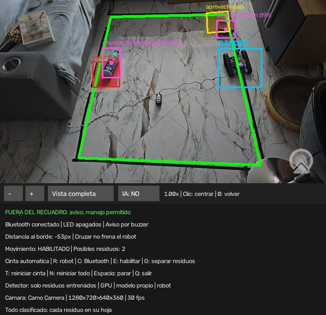

# Manual de uso

Actualizado: 2 de noviembre de 2026

Documento principal: [Documentación técnica del sistema](DOCUMENTACION_TECNICA.md).

[Inicio](../README.md) · [Instalación](INSTALACION.md) · [Operación](OPERACION_V2.md) · [Problemas](PROBLEMAS.md)

Esta guía explica cómo montar la escena, abrir el programa y hacer que el robot separe los residuos. Todo se hace en el **Mac del proyecto** con la instalación ya hecha ([Instalación](INSTALACION.md)). Los comandos se escriben en Terminal desde la carpeta del proyecto (la que contiene `README.md` y `outputs`).

## Antes de empezar: el montaje

Comprueba esta lista antes de abrir nada:

1. **Recuadro de cinta negra** pegado en un suelo claro. Deben verse sus cuatro lados y sus esquinas.
2. **Dos hojas de papel de color dentro del recuadro**: una **amarilla** (aprovechables) y una **roja** (peligrosos). Planas, sin pliegues y bien visibles.
3. **Residuos dentro del recuadro y fuera de sus hojas**. Déjalos separados de la cinta, al menos a un robot de distancia: si están pegados a ella, el robot tiene que salir del recuadro para colocarse detrás y puede perderse de vista (ver [Problemas](PROBLEMAS.md#problemas-conocidos-del-prototipo)). Los residuos que conoce el programa son: caja de cartón, lata, botella de plástico y envase de blanqueador (la botella de vidrio casi no se detecta).
4. **El robot dentro del recuadro**, encendido, con el firmware V2 cargado ([Operación](OPERACION_V2.md#firmware-v2-qué-es-y-cómo-se-carga)) y con batería. Sin cables que tiren de él.
5. **El teléfono fijo** encima de la zona, en horizontal, mirando hacia abajo con la cámara trasera. Debe ver el recuadro entero y una franja de suelo alrededor. **No lo sujetes con la mano**: con la imagen movida el recuadro no se confirma.
6. **Luz** uniforme, sin sombras fuertes ni reflejos sobre la cinta.
7. **Nada importante en la esquina inferior derecha** de la imagen: ahí está el logo de Camo y el programa ignora lo que haya.

## Lanzadores

Son archivos `.command` de la carpeta `outputs/`. Se abren con doble clic en Finder o desde Terminal.

| Lanzador | Para qué |
|---|---|
| `outputs/Probar_Robot_Linea.command` | **El programa principal con el robot.** Es el que se usa en la demostración. Abre también el panel web. |
| `outputs/n8n/Abrir_n8n.command` | Abre n8n, que apunta cada residuo separado en Google Sheets. Opcional. |
| `outputs/Abrir_Dashboard.command` | Solo el panel web, sin cámara, para consultar resultados anteriores. |
| `outputs/Actualizar_Ranger.command` | Carga el firmware en el robot por USB. |
| `outputs/Recoger_Imagenes.command` | Toma fotos para entrenar el detector ([Entrenamiento](ENTRENAMIENTO.md)). |
| `outputs/Detectar_Residuos.command` | El programa principal sin robot, solo para ver lo que detecta. |

## La demostración, paso a paso

1. Abre **Camo Studio** en el Mac y la aplicación **Camo** en el teléfono. Comprueba que se ve la imagen de la cámara trasera y que el teléfono tiene batería (o está cargando).
2. (Opcional) Abre `outputs/n8n/Abrir_n8n.command` y deja esa ventana de Terminal abierta. Configurar n8n la primera vez se explica en [N8N.md](N8N.md).
3. Abre `outputs/Probar_Robot_Linea.command`. La primera vez tarda un poco: carga los modelos de inteligencia artificial.
4. Espera a que en la ventana del vídeo aparezcan:
   - el **recuadro en verde** (se elige solo cuando se ve estable: al menos 6 imágenes seguidas en 0,4 s);
   - las **hojas** con su color y los rótulos «aprovechables» y «peligrosos» (tardan alrededor de un segundo más);
   - el **robot** dentro de una caja azul con el rótulo «RANGER»;
   - los **residuos** dentro de cajas moradas con su nombre.
5. Abre el panel en el navegador: **http://127.0.0.1:8765**. Debe mostrar la cámara en vivo.
6. Haz clic en la ventana del vídeo (las teclas solo funcionan con ella activa, en minúsculas) y pulsa **C** para conectar el Bluetooth. Espera a leer «Bluetooth conectado | LED apagados | Aviso por buzzer».
7. Pulsa **E** para habilitar el movimiento. La cuarta línea de texto debe decir «Movimiento: HABILITADO».
8. Pulsa **G**. El robot empieza a separar: va a un residuo, se coloca detrás, lo empuja hasta su hoja, retrocede y sigue con el siguiente. La última línea de texto dice qué está haciendo.
9. Cada vez que un residuo queda en su hoja, el panel muestra un aviso «+1» y suma uno. Si n8n está abierto, aparece también su respuesta («Apuntado en Google Sheets…»). **Retira a mano el residuo contado**: la hoja amarilla es pequeña y un residuo empujado podría sacar a otro.
10. Al terminar, el robot pita y la última línea dice «Todo clasificado: cada residuo en su hoja».
11. Para parar en cualquier momento: **Espacio**. Para seguir después: **E** y **G**.
12. Para salir: **Q** en la ventana del vídeo. Cierra n8n con Ctrl+C en su ventana de Terminal.

Si algo se detiene a mitad, mira la tabla de [mensajes frecuentes](#mensajes-frecuentes).

## Qué se ve en la ventana



Dibujos sobre la imagen:

| Dibujo | Significado |
|---|---|
| Cuadrilátero **verde** | Recuadro de cinta confirmado y visible. **Naranja**: se recuerda, pero ahora no se ve bien (el robot no se mueve). |
| Rectángulos **amarillo** y **rojo** con rótulo | Hojas reconocidas: «aprovechables» (amarilla) y «peligrosos» (roja). |
| Caja **azul** «RANGER» | El robot que se está siguiendo. |
| Cajas **moradas** con nombre y porcentaje | Residuos detectados y la confianza del detector. «(seguimiento)» quiere decir que se muestra por su última detección, de hace un momento. |
| Cajas **amarillas** «objeto por identificar» | Algo dudoso. No se cuenta ni se empuja. Solo aparece con los detectores generales encendidos. |
| Círculo **celeste** sobre el robot, línea y círculo alrededor del residuo | El plan del modo automático: el robot va hacia ese residuo. Un punto celeste pequeño marca dónde se colocará detrás de él. |
| Flecha **naranja** desde el residuo | Hacia dónde lo va a empujar (el centro de su hoja). |
| Flecha **amarilla** desde el robot | Hacia dónde cree el programa que mira el robot. |

Líneas de texto bajo la imagen, de arriba abajo:

1. Estado del recuadro (verde si el robot puede moverse, rojo si no).
2. Estado del Bluetooth.
3. Distancia del robot a la cinta, en píxeles (negativa si está fuera).
4. «Movimiento: HABILITADO» o «BLOQUEADO», y cuántos residuos se ven.
5. y 6. Recordatorio de las teclas.
7. Estado del detector. Lo normal: «Detector: solo residuos entrenados | GPU | modelo propio | robot».
8. Cámara, tamaño de la imagen y su copia de análisis, e imágenes por segundo.
9. Qué está haciendo el modo automático.

## Teclas

| Tecla | Qué hace |
|---|---|
| `c` | Conectar el Bluetooth con el robot. Al conectar, para los motores y apaga los LED. |
| `e` | Habilitar el movimiento. Solo funciona con el recuadro visible, el robot seguido y el Bluetooth conectado. |
| `g` | Iniciar o detener el modo automático. Necesita lo mismo que `e` y que el movimiento esté habilitado; si falta algo, no arranca. |
| Espacio o `x` | Parar ya: detiene el robot, deshabilita el movimiento y apaga el modo automático. |
| `w` `a` `s` `d` | Un paso manual de 0,15 s: adelante, izquierda, atrás, derecha. Apaga el modo automático. |
| `r` | Elegir el robot con el ratón (respaldo si no se encuentra solo): arrastra un rectángulo que incluya todo el robot, orugas incluidas, y pulsa Enter. |
| `t` | Borrar el recuadro y las hojas y buscarlos de nuevo. Conserva el robot. Úsalo si moviste la cámara. |
| `n` | Reiniciar todo: recuadro, hojas y robot. |
| `b` | Confirmar a mano el recuadro que se ve en amarillo (o una sola línea de cinta). |
| `+` / `=`, `-`, `0`, `i` | Zoom, vista completa y mejora con IA (ver [Zoom](#zoom-e-inspección-de-objetos)). |
| `q` | Salir (también cerrando la ventana). |

`t`, `n`, `b` y `r` detienen el robot y deshabilitan el movimiento: después hay que pulsar `e` (y `g`) otra vez.

## Mensajes frecuentes

| Mensaje | Qué pasa | Qué hacer |
|---|---|---|
| «Lineas detectadas: N - buscando recuadro» o «RECUADRO: estabilizando seleccion automatica...» | Todavía no hay recuadro confirmado. | Espera. Si no llega, comprueba que se ven los cuatro lados, pulsa `t`, o `b` para confirmar el candidato amarillo. |
| «Borde conservado; esperando cinta visible. Robot detenido.» | La cinta no se ve bien (algo la tapa, cambió la luz, se movió la cámara). | Destápala. Si se movió la cámara, pulsa `t`. Después, **E** y **G**. |
| «Recuadro perdido o imagen atrasada: detener» | Se perdió el recuadro o la imagen llegó tarde. El robot queda deshabilitado a propósito. | Cuando vuelva el recuadro verde, pulsa **E** y **G**. |
| «Selecciona TODO el Ranger con R» | No se está siguiendo al robot. | Espera a que el detector lo encuentre, o pulsa `r`. Después, **E** y **G**. |
| «Bluetooth lento (1/3): se reintenta» | Una confirmación del robot tardó. | Nada; si pasa a «Bluetooth detenido: …», pulsa **C**, **E** y **G**. |
| «Automatico detenido: robot no habilitado o sin conexion» | Se cortó el Bluetooth o se deshabilitó el movimiento. | **C** (si hace falta), **E** y **G**. |
| «Automatico detenido: robot no seguido» | Se perdió de vista el robot. | Espera a que vuelva la caja azul (o pulsa `r`), luego **E** y **G**. |
| «Automatico detenido: el robot no avanza (revisa baterias, orugas o seguimiento)» | Varios pasos sin moverse. | Revisa baterías, que nada lo atasque y que la caja azul esté sobre el robot. |
| «Automatico: volviendo al recuadro (marcha atras)» | El robot salió del recuadro y vuelve solo. | Nada. |
| «Automatico: comprobando que no quede nada debajo del robot» | Antes de terminar, retrocede un paso por si tapaba un residuo. | Nada. |
| «FUERA DEL RECUADRO: aviso; manejo permitido» | El robot está fuera de la cinta. El buzzer pita cada 2 s. | Nada en automático; a mano, vuelve a meterlo. |
| «Todo clasificado: cada residuo en su hoja» | Terminó: no quedan residuos fuera de su hoja. | Fin. |
| «Recuadro limpio» | Terminó sacando del recuadro residuos que no tienen hoja. | Fin. |
| «Automatico: no hay residuos dentro del recuadro» | No ve residuos por separar. | Comprueba que se ven las cajas moradas. |

## El panel web

Se abre solo con el programa principal en **http://127.0.0.1:8765**. Solo se puede ver desde el mismo Mac. Muestra:

- **Cámara en vivo**, con el recuadro, el robot y los residuos marcados.
- **«Residuos separados correctamente»** en grande, y debajo cuántos hay en la hoja amarilla (aprovechables) y en la roja (peligrosos).
- **«Por separar ahora»**: residuos dentro del recuadro que todavía no están en su hoja. Y si el robot está conectado.
- **Últimas separaciones**, con el aviso «+1 · Lata → hoja amarilla» cada vez que se cuenta uno.
- **Automatización n8n**: CONECTADO, SIN RESPUESTA, APAGADO o PROGRAMA CERRADO, cuántas filas se han escrito en Google Sheets y las últimas respuestas de n8n.
- Indicadores de la sesión, histórico acumulado, gráfico del progreso, reparto por tipo de residuo, registro y botón **Exportar CSV** (para abrir en una hoja de cálculo).

Cada vez que se abre el programa empieza una **sesión nueva** (el contador vuelve a 0); las anteriores se conservan y se eligen en el selector «Sesión». Para poner el panel a cero, cierra el programa y vuelve a abrirlo. Los datos se guardan en `work/estadisticas.sqlite3`: no lo borres.

`Abrir_Dashboard.command` abre solo el panel, sin cámara («Sin imagen de la cámara»), para revisar sesiones anteriores. No hace falta si el programa principal está abierto. Qué cuenta exactamente como «separado» se explica en [Operación](OPERACION_V2.md#cuándo-cuenta-un-residuo).

## n8n y Google Sheets

Cada residuo contado se envía a n8n (en este mismo Mac, http://localhost:5678), que lo apunta como fila en una hoja de Google Sheets (fecha, hora, residuo, hoja, grupo, confianza, sesión y total) y contesta un mensaje que aparece en el panel. El envío va aparte: si n8n está cerrado, el robot sigue igual y los avisos se reintentan cada 5 s mientras el programa esté abierto. Solo se envían datos del conteo, nunca imágenes.

- Para no enviar nada: `--sin-n8n`.
- Para otra dirección: `--n8n URL` (por defecto `http://localhost:5678/webhook/residuos`).

La instalación y configuración de n8n están en [N8N.md](N8N.md).

## Manejar el robot a mano

Con el recuadro verde, el robot seguido, **C** y **E**:

- `w`, `a`, `s`, `d` dan pasos de 0,15 s. Mantener la tecla pulsada repite pasos.
- El robot puede acercarse a la cinta y cruzarla: no se frena. Cuando sale del recuadro (más de 5 px durante 0,25 s), el buzzer pita cada 2 s sin parar los motores.
- Espacio o `x` paran.

Un residuo que queda en su hoja cuenta igual, lo empuje el robot en automático, con las teclas o lo coloques con la mano.

## Ver residuos sin robot

```sh
work/venv/bin/python outputs/vision_linea_robot.py --solo-vision
```

Es lo mismo que `outputs/Detectar_Residuos.command`. No conecta el Bluetooth ni busca el robot. Sirve para comprobar la cámara, el recuadro, las hojas y los residuos antes de la demostración. El conteo, el panel y n8n funcionan igual: si colocas a mano un residuo en su hoja, se cuenta. Teclas: `t` (reiniciar recuadro) y `q` (salir).

## Cámara: LifeCam o Samsung Galaxy

El programa usa siempre una cámara externa, **nunca la del Mac**. Si hay una sola reconocida (Samsung, Camo o Microsoft LifeCam), la elige sola; si no encuentra ninguna, se detiene y enseña la lista.

Con el **Samsung Galaxy S24 Ultra** se usa **Camo**, porque este teléfono no ofrece la opción «Cámara web» por USB:

1. Instala **Camo** en el teléfono y **Camo Studio** en el Mac (se usó la versión 2.9.0).
2. Activa la extensión de cámara de Camo en el Mac: Ajustes del Sistema → General → Ítems de inicio y extensiones → Extensiones de cámara.
3. Conecta el teléfono por USB (o Wi-Fi), abre Camo y elige la **cámara trasera**.
4. Comprueba qué cámaras ve el Mac:

   ```sh
   work/venv/bin/python outputs/vision_linea_robot.py --listar-camaras
   ```

5. Si hay más de una reconocida, elige con `--camara camo`, `--camara samsung`, `--camara lifecam`, parte del nombre o su número en la lista.

Notas:

- Al arrancar, el programa indica el tamaño que entrega de verdad la cámara (por ejemplo 1280 × 720 a 30 imágenes por segundo). El análisis trabaja con una copia de 640 px de lado mayor; los detectores y el zoom usan la original. `--resolucion 1920x1080` pide otro tamaño.
- Si Camo pierde el teléfono, envía imágenes negras con su logo. Si el robot está en marcha y la imagen no cambia en 0,6 s, el programa lo detiene.
- Cuanto más lejos está el teléfono, más pequeños se ven los residuos (en la vista de trabajo miden unos 20-40 px) y peor se detectan. Ponlo lo más cerca posible viendo aún todo el recuadro.
- La LifeCam (640 × 480) sigue funcionando, pero los detectores propios se entrenaron con imágenes del Samsung.

## Zoom e inspección de objetos

Solo cambia lo que **ves**; el recuadro, el robot y el conteo siguen usando la imagen completa.

- Botones **+** y **−** o teclas `+`/`=` y `-`: zoom de 1× a 4×.
- Clic sobre un objeto: centra la vista ahí. Clic en la miniatura de la esquina: desplaza.
- **Vista completa** o `0`: vuelve a 1×.
- `--zoom 2` arranca ampliado.

Con el teléfono, el recorte sale de la imagen original, así que muestra detalle real.

## Mejora de resolución con IA

El botón **IA** o la tecla `i` activan una mejora ×2 (FSRCNN) sobre la vista ampliada. Es solo para mirar: no cambia lo que detecta el programa. Si tarda más de 150 ms, se apaga sola. Se arranca con `--mejora-ia --zoom 2`. Su modelo (39 KB) lo descarga `preparar_modelos.py`, o solo él con `--solo-superres`.

## Diagnóstico

```sh
work/venv/bin/python outputs/vision_linea_robot.py --diagnostico work/diagnostico
```

Cada segundo guarda, sobrescribiendo, `camara.jpg` (imagen de la cámara), `vista.jpg` (la ventana con los dibujos) y `estado.json` (estado del recuadro, robot, Bluetooth, detecciones, modo automático, n8n, tiempo de cada vuelta y antigüedad de la imagen). Sirve para revisar una prueba después. Guárdalo dentro de `work/`, que no se sube a GitHub: son fotos reales de la casa.

## Todas las opciones del programa principal

```sh
work/venv/bin/python outputs/vision_linea_robot.py --help
```

| Opción | Qué hace |
|---|---|
| `--camara NOMBRE` | Elegir cámara: `camo`, `samsung`, `lifecam`, parte del nombre o número. |
| `--resolucion ANCHOxALTO` | Pedir un tamaño de captura. |
| `--listar-camaras` | Mostrar las cámaras del Mac y salir. |
| `--solo-vision` | Sin robot ni Bluetooth. |
| `--conectar` | Conectar el Bluetooth al arrancar (no habilita el movimiento). |
| `--nombre NOMBRE` | Nombre Bluetooth del robot (por defecto `Makeblock_LE10a56219eb91`). |
| `--diagnostico CARPETA` | Guardar imágenes y estado cada segundo. |
| `--dashboard-port PUERTO` | Otro puerto para el panel (por defecto 8765). |
| `--sin-dashboard` | No abrir el panel (el conteo se sigue guardando). |
| `--n8n URL` | Otra dirección del webhook de n8n. |
| `--sin-n8n` | No enviar nada a n8n. |
| `--modelo-propio RUTA` / `--sin-modelo-propio` | Otro detector de residuos entrenado / no usarlo. |
| `--modelo-robot RUTA` / `--sin-modelo-robot` | Otro detector del robot / buscar el robot solo con Grounding DINO. |
| `--otros-residuos` | Encender también los detectores generales: más tipos de residuo, muchas más confusiones. |
| `--modelo RUTA`, `--clases a,b` | Detector general y filtro de sus clases. |
| `--zoom N`, `--mejora-ia` | Zoom inicial y mejora con IA. |
| `--velocidad-max`, `--margen` | Se conservan por compatibilidad; ya no frenan al robot. |

## Modos antiguos

Se conservan por historia; no se usan en la demostración.

- `outputs/vision_linea.py` (`Detectar_Linea.command`): marca líneas negras sueltas, sin robot.
- `outputs/vision_ranger.py` ejecutado directamente: el primer modo, con una etiqueta ArUco impresa (`outputs/Etiqueta_Ranger.png`) pegada encima del robot. El modo actual no la necesita.
- `outputs/ranger_bluetooth.py` sin argumentos: consola Bluetooth sin cámara ([Robot](ROBOT.md)).
